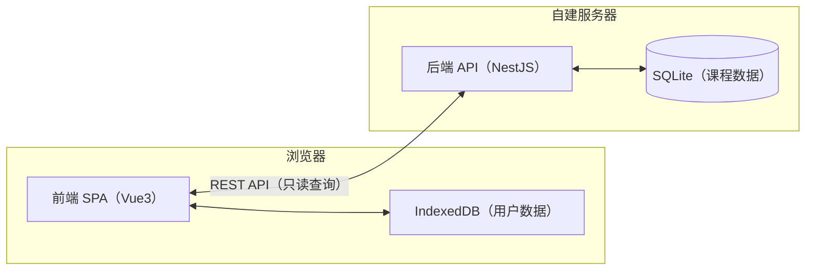

# 课程查询与选课排课系统（Hydrangea）设计文档（DESIGN）

## 变更记录

| 版本 | 日期 | 作者 | 变更说明 |
| --- | --- | --- | --- |
| v1.0 | 2026-09-21 | Niazye | 初稿创建。基于 PRD v1.1 与已确认的技术选型，完全重新设计 |
| v1.1 | 2026-09-23 | Niazye | 搜索结果支持多布局共存：新增 `core/format.ts` 纯函数（格式化周次/时间），`components/search/layouts/` 存放各布局组件，`ClassList.vue` 作为布局门面按 `layout` 分发；新增 §4.5 搜索结果多布局 |

| 项目名称 | 课程查询与选课排课系统（Hydrangea） |
| --- | --- |
| 文档版本 | v1.1 |
| 编写日期 | 2026-09-23 |
| 文档状态 | 完整版，待评审 |
| 目标读者 | 前后端开发、测试、运维 |

> **说明**：本文件为本项目**唯一权威设计文档**，与 `docs/PRD.md`（唯一权威需求）配套。若与 PRD 冲突，以 PRD 为准并同步修订本文件。

---

## 1. 技术架构

### 1.1 架构总览

本系统采用**前后端分离**架构：前端为单页应用（SPA），后端为只读查询 API 服务。



**数据边界**（与 PRD §2、§6.3 一致）：
- **课程数据**：存于后端 SQLite，由爬虫全量替换维护，前端只读查询。
- **用户数据**（方案/标记）：存于浏览器 IndexedDB，后端不参与、不感知。

### 1.2 技术栈明细

| 层 | 技术 | 说明 |
| --- | --- | --- |
| 前端框架 | Vue 3 + TypeScript + Vite | 组合式 API |
| 前端状态 | Pinia | 全局状态管理 |
| 前端 UI | Material You（MD3） | 视觉风格 |
| 前端本地存储 | IndexedDB（idb 封装） | 用户数据持久化 |
| 后端框架 | NestJS + TypeScript | 只读查询 API |
| 后端数据库 | SQLite（better-sqlite3） | 课程数据 |
| 爬虫 | Python 独立脚本 | 独立仓库，离线运行 |
| 包管理 | pnpm workspaces | monorepo |
| 部署 | Docker Compose | 自建服务器 |

---

## 2. 数据模型

### 2.1 课程数据表（后端 SQLite）

课程数据**仅一张表** `teaching_classes`，由爬虫全量替换维护。

| 字段 | 类型 | 说明 |
| --- | --- | --- |
| `id` | INTEGER PK | 自增主键 |
| `class_code` | TEXT | 教学班代码，唯一，默认排序依据 |
| `course_code` | TEXT | 课程代码（与大纲 `id` 无关） |
| `course_name` | TEXT | 课程名称 |
| `total_hours` | INTEGER | 总学时 |
| `credits` | REAL | 学分 |
| `teacher` | TEXT | 授课教师 |
| `schedule` | TEXT | 上课时间（JSON 数组，见 2.2） |
| `location` | TEXT | 上课地点（与时间段对应） |
| `weeks` | TEXT | 周次（JSON 数组，见 2.3） |
| `level` | TEXT | 培养层次（本科生/研究生/辅修、微专业） |
| `course_type` | TEXT | 课程类型（仅筛选） |
| `course_nature` | TEXT | 课程性质（仅筛选） |
| `department` | TEXT | 开课部门（仅筛选） |
| `teaching_composition` | TEXT | 教学组成 |
| `remark` | TEXT | 备注 |
| `syllabus_id` | INTEGER | 课程大纲 `id` 参数（用于拼接链接） |

> **说明**：
> - `schedule` 支持**多段**上课时间（PRD §3.6.3），每段含「星期 + 节次区间」。
> - `weeks` 为实际开课周，可能不连续、可能单/双周（PRD §3.6.2）。
> - 课程类型/性质/部门**仅用于筛选**，不在结果展示（PRD §3.1.2）。

### 2.2 上课时间（schedule）结构

`schedule` 为 JSON 数组，每段表示一个时间段：

```json
[
  { "day": 1, "start": 1, "end": 2, "location": "教 101" },
  { "day": 3, "start": 6, "end": 8, "location": "实验楼 302" }
]
```

| 字段 | 说明 |
| --- | --- |
| `day` | 星期几（1=周一 … 7=周日） |
| `start` / `end` | 节次区间（1–14，含端点） |
| `location` | 该时间段的上课地点 |

> 每段可独立携带 `location` 与 `weeks`（PRD §3.1.4 上课地点与时间段对应）。

### 2.3 周次（weeks）结构

`weeks` 为 JSON 数组，表示实际开课周：

```json
[1, 2, 3, 5, 7, 9]
```

> 周次可能不连续、可能仅单周或仅双周（PRD §3.6.2）。系统**不硬编码学期周数**（PRD §3.6.1）。

### 2.4 用户数据（前端 IndexedDB）

用户数据**不建表、不入库**，存于浏览器 IndexedDB。数据结构：

| 存储对象 | 内容 |
| --- | --- |
| `plans` | 排课方案列表（含名称、学期、标记） |
| `settings` | 全局设置（当前学期、当前方案等） |

**方案（plan）结构**：

```json
{
  "id": "uuid",
  "name": "方案 1",
  "semester": "2026-2027-1",
  "marks": [
    { "classCode": "A001", "intent": true, "scheduled": true, "addedAt": 1234567890 }
  ]
}
```

| 字段 | 说明 |
| --- | --- |
| `id` | 方案唯一标识 |
| `name` | 方案名称（允许重名） |
| `semester` | 绑定学期 |
| `marks` | 标记列表，`intent`=意向，`scheduled`=已排 |

> **标记规则**（PRD §3.2）：
> - `intent=true` 表示有意向标记；`scheduled=true` 表示已排（已排是意向的子集）。
> - 移除意向时级联移除已排（`intent=false` 时 `scheduled` 强制为 `false`）。
> - 占位条目：`intent=true` 但课程数据中不存在该 `classCode`。

---

## 3. API 契约

后端为**只读查询服务**，不提供任何写接口。所有接口返回 JSON。

### 3.1 接口总览

| 方法 | 路径 | 说明 |
| --- | --- | --- |
| GET | `/api/semesters` | 获取可用学期列表 |
| GET | `/api/classes` | 查询教学班（支持关键词 + 筛选 + 分页） |
| GET | `/api/classes/:classCode` | 获取单个教学班详情 |
| GET | `/api/filters` | 获取筛选选项（课程类型/性质/部门，自动适应） |

### 3.2 查询教学班 `GET /api/classes`

**请求参数**：

| 参数 | 类型 | 说明 |
| --- | --- | --- |
| `semester` | string | 学期标识（必填） |
| `keyword` | string | 关键词（模糊匹配所有文本字段） |
| `courseType` | string | 课程类型筛选 |
| `courseNature` | string | 课程性质筛选 |
| `department` | string | 开课部门筛选 |
| `level` | string | 培养层次筛选 |
| `page` | number | 页码（默认 1） |
| `pageSize` | number | 每页条数（默认 20） |

**响应**：

```json
{
  "total": 128,
  "page": 1,
  "pageSize": 20,
  "items": [
    {
      "classCode": "A001",
      "courseCode": "CS101",
      "courseName": "数据结构",
      "totalHours": 48,
      "credits": 3,
      "teacher": "张三",
      "schedule": [{ "day": 1, "start": 1, "end": 2, "location": "教 101" }],
      "weeks": [1, 2, 3, 5, 7, 9],
      "level": "本科生",
      "teachingComposition": "2026级1班",
      "remark": "",
      "syllabusUrl": "https://byyt.ecnu.edu.cn/.../form/123456"
    }
  ]
}
```

> **排序**：固定按 `class_code` 升序（PRD §3.1.3）。
> **筛选与展示分离**：响应不含 `courseType`/`courseNature`/`department`（仅筛选，不展示，PRD §3.1.2）。

### 3.3 获取筛选选项 `GET /api/filters`

**请求参数**：`semester`（必填）

**响应**：

```json
{
  "courseTypes": ["通识", "专业"],
  "courseNatures": ["必修", "选修"],
  "departments": ["计算机科学与技术学院", "数学学院"]
}
```

> 三项选项**根据数据自动适应**（PRD §6.2）；培养层次选项**固定为三个**（本科生/研究生/辅修、微专业），由前端维护，不在此接口返回。

---

## 4. 前端设计

### 4.1 页面结构

双页面（PRD §3.2.1），路由：

| 路由 | 页面 | 职责 |
| --- | --- | --- |
| `/search` | 搜索页 | 查询、筛选、打意向标记 |
| `/schedule` | 排课页 | 查看课表、打已排标记、方案管理 |

**布局**：两页均左右分栏，左侧副栏（搜索/筛选/意向列表/方案管理/学期切换），右侧主栏（结果/课表）。窄屏用汉堡按钮展开/收起副栏。

### 4.2 组件结构

```
src/
├── core/                    # 纯函数，零框架依赖
│   ├── format.ts            # 格式化（周次、上课时间等），供各布局共用
│   ├── marks.ts             # 标记规则（意向/已排联动）
│   ├── placeholders.ts      # 占位条目判定
│   ├── conflict.ts          # 冲突检测
│   ├── timetable.ts         # 课表生成
│   ├── weeks.ts             # 周次处理
│   └── slots.ts             # 节次定义
├── codec/                   # 编解码
│   ├── plancode.ts          # 排课码门面
│   ├── binary.ts            # 排课码二进制编解码
│   ├── ics.ts               # ICS 生成
│   └── image.ts             # PNG 导出
├── stores/                  # Pinia 状态
├── storage/                 # IndexedDB 封装
├── api/                     # 后端 API 客户端
├── components/
│   ├── layout/              # 布局（副栏、汉堡按钮、学期切换）
│   ├── search/              # 搜索页组件
│   │   ├── ClassList.vue    # 搜索结果布局门面（按 layout 分发）
│   │   └── layouts/         # 各布局组件，互不依赖
│   │       ├── CardLayout.vue      # 卡片布局
│   │       └── TableLayout.vue     # 表格布局
│   ├── schedule/            # 排课页组件
│   ├── export/              # 导出组件
│   ├── import/              # 导入组件
│   └── common/              # 通用组件
└── views/                   # 页面
```

> **核心原则**：`core/` 与 `codec/` 为**纯函数**，零框架依赖，便于单元测试与复用。

### 4.5 搜索结果多布局

搜索结果支持**多种布局共存**，以便后续选择某一种或添加切换布局功能。架构遵循「数据与展示分离」：

- **格式化逻辑**集中在 `core/format.ts`（纯函数），所有布局共用，不重复。
- **每种布局一个独立组件**，存放于 `components/search/layouts/`，互不依赖、互不影响。
- **`ClassList.vue` 作为布局门面**，接收 `layout` prop，按类型分发到对应布局组件。

**布局类型**：字符串字面量联合类型 `'card' | 'table' | 'wide-table'`（当前已实现 `card`、`table`）。

**新增一种布局**：新建 `layouts/*.vue`（只接收 `items`，用 `core/format.ts` 格式化），并在 `ClassList.vue` 门面中注册一行分发即可，不影响其他布局与业务代码。

**未来加切换**：只需在搜索页某处维护一个 `layout` 状态并传给 `ClassList`，无需改动各布局组件。

### 4.3 状态管理（Pinia）

| Store | 职责 |
| --- | --- |
| `courseStore` | 课程查询结果、筛选选项 |
| `planStore` | 当前方案、方案列表、标记操作 |
| `uiStore` | 当前学期、副栏展开状态 |

### 4.4 本地存储（IndexedDB）

- 使用 `idb` 库封装 IndexedDB。
- 存储 `plans`（方案列表）与 `settings`（当前学期/当前方案）。
- 提供「清空所有数据」入口（PRD §4 数据持久性）。

---

## 5. 排课码格式

### 5.1 概述

排课码用于**跨设备转移与备份**（PRD §3.4.4），通过剪贴板导出/导入。格式为**自定义二进制 + Base64URL 编码**，前缀 `CP1-`。

### 5.2 格式定义

```
CP1-<payload>
```

`payload` 为 Base64URL 编码的二进制数据，结构如下：

| 段 | 长度 | 说明 |
| --- | --- | --- |
| version | 1B | 版本号（当前 1） |
| flags | 1B | 标志位（保留） |
| semester | 3B | 学期标识（BCD 编码） |
| count | 2B | 教学班数量（大端） |
| checksum | 2B | CRC-16/CCITT 校验 |
| entries | 变长 | 教学班条目 |

**entry 结构**：

| 段 | 长度 | 说明 |
| --- | --- | --- |
| level | 1B | 标记级别（1=意向，2=已排） |
| classCodeLen | 1B | 教学班代码长度 |
| classCode | 变长 | 教学班代码（UTF-8） |

### 5.3 导入校验

导入时（PRD §3.4.6）：
1. **格式校验**：前缀、版本、CRC 校验，无效则提示错误，不新建方案。
2. **学期校验**：排课码学期与当前学期不匹配时，提示用户决定是否继续。
3. **方案上限校验**：方案数达上限（10）时阻止导入。
4. **缺失课程处理**：无法匹配的教学班代码转为占位条目。

---

## 6. 导出方案

### 6.1 ICS 导出

- 前端生成 `.ics` 文件（PRD §3.4.2）。
- 同一教学班为**重复事件（RRULE）**，非多个独立事件。
- 事件标题仅含课程名；可选项含教师、地点。
- 兼容 Google Calendar / Outlook / Apple Calendar。

### 6.2 PNG 导出

- 前端渲染课表为 PNG 图片（PRD §3.4.3）。
- 固定内容：周次信息、方案名称。
- 自定义选项：表格大小、尺寸、是否含周末、周次信息、是否含教师、是否含地点。

### 6.3 剪贴板导出

- 排课码与教学班代码文本均通过**剪贴板**导出（PRD §3.4.1）。
- 教学班代码文本仅含**已排**教学班代码（PRD §3.4.5）。

---

## 7. 核心算法

### 7.1 冲突检测

冲突判定（PRD §3.6.4）：两个教学班在**同一星期几**、**节次区间有交集**、且**周次有交集**时冲突。

```ts
function isConflict(a: Schedule[], b: Schedule[]): boolean {
  for (const sa of a) {
    for (const sb of b) {
      if (sa.day !== sb.day) continue;
      if (!(sa.start <= sb.end && sb.start <= sa.end)) continue; // 节次区间交集
      if (!hasWeekOverlap(sa.weeks, sb.weeks)) continue;         // 周次交集
      return true;
    }
  }
  return false;
}
```

> 冲突**允许排入**，不做阻止（PRD §3.3.2）。多冲突统一按冲突样式表现。

### 7.2 课表生成

- 根据已排教学班生成一周课表（周一至周日 × 14 节次）。
- 每个教学班按 `schedule` 各段填充对应单元格。
- 冲突单元格以**方形圆点 + 文本标红**表现（PRD §3.3.2）。

### 7.3 周次处理

- 周次为数组，支持不连续、单/双周（PRD §3.6.2）。
- 课表单元格内用圆点表示周次：有课填充、无课描线、冲突方形（PRD §3.3.3）。
- 提供按周查看功能。

---

## 8. 项目结构

pnpm workspaces monorepo：

```
Hydrangea/
├── apps/
│   ├── web/                 # 前端（Vue3 + Vite）
│   │   ├── src/
│   │   └── package.json
│   └── server/              # 后端（NestJS）
│       ├── src/
│       └── package.json
├── data/                    # SQLite 数据卷（volume）
├── deploy/
│   └── nginx/
│       └── nginx.conf       # 反向代理配置
├── docker-compose.yml
├── package.json             # 根（pnpm workspace）
├── pnpm-workspace.yaml
└── docs/
    ├── PRD.md
    └── DESIGN.md
```

> **爬虫为独立仓库**，不入本仓库（决策 6A）。

---

## 9. 部署方案

Docker Compose 编排（决策 8A）：

```yaml
services:
  server:
    build: ./apps/server
    volumes:
      - ./data:/data
  web:
    build: ./apps/web
  nginx:
    image: nginx
    ports:
      - "80:80"
    volumes:
      - ./deploy/nginx/nginx.conf:/etc/nginx/nginx.conf
```

- `server`：NestJS API，挂载 `data/` 卷存 SQLite。
- `web`：Vue3 构建产物。
- `nginx`：反向代理，将 `/api` 转发到 server，其余到 web。

---

## 10. 测试策略

| 层 | 工具 | 范围 |
| --- | --- | --- |
| 前端单元测试 | Vitest | `core/`、`codec/` 纯函数 |
| 后端集成测试 | Vitest + Supertest | API 接口 |
| 端到端测试 | Playwright | 关键用户流程 |

> 前后端统一使用 **Vitest**，减少工具链差异。

---

## 11. 附录

### 11.1 参考
- [iCalendar 规范 (RFC 5545)](https://datatracker.ietf.org/doc/html/rfc5545)
- [Vue 3](https://vuejs.org/)
- [NestJS](https://nestjs.com/)
- [Vite](https://vitejs.dev/)
- [Pinia](https://pinia.vuejs.org/)
- [better-sqlite3](https://github.com/WiseLibs/better-sqlite3)
- [idb](https://github.com/jakearchibald/idb)
- [Docker Compose](https://docs.docker.com/compose/)