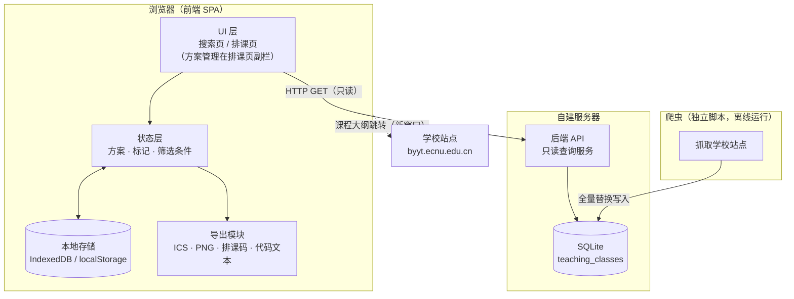
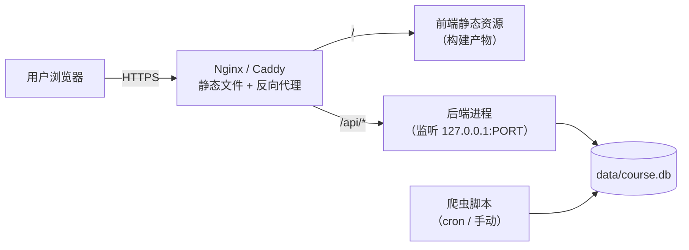
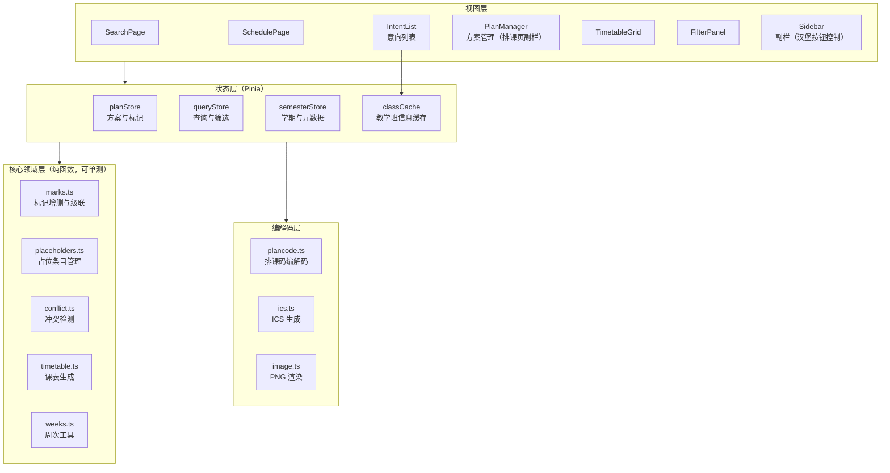
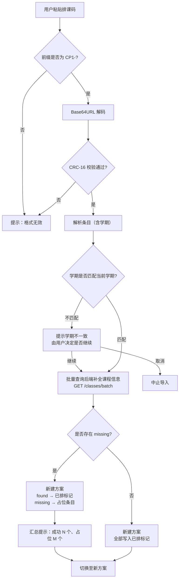
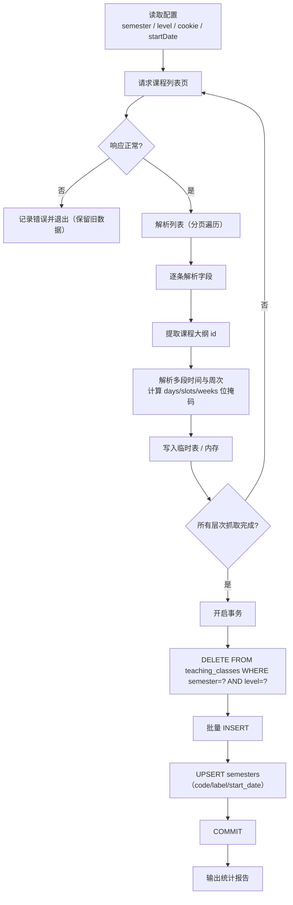
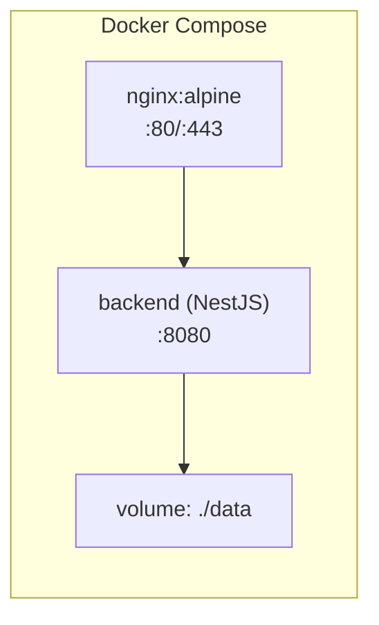

# 课程查询与选课排课系统（course-plus）设计文档

## 变更记录

| 版本 | 日期 | 作者 | 变更说明 |
| --- | --- | --- | --- |
| v0.1 | 2026-09-17 | Niazye | 初稿：依据 PRD-formal v1.3 编写系统架构、数据模型、API、前端设计、排课码格式与测试策略 |
| v0.2 | 2026-09-17 | Niazye | 同步 PRD-formal v1.4：新增排课页意向列表设计（含课程名/课程代码）；新增「占位条目」数据模型、导入流程、UI 与测试用例 |
| v0.3 | 2026-09-17 | Niazye | 同步 PRD-formal v1.5：接收从 PRD 移出的设计阶段问题（字段清单、筛选条件、导出图片选项、成功指标、爬虫范围与频率），新增 D-18~D-22；修正因 PRD 章节重编号而失效的引用 |
| v1.0 | 2026-09-17 | Niazye | **正式版**：依据 PRD-formal v1.7 全面定稿。技术选型、数据模型、API、前端、排课码、导出、爬虫、部署等设计决策全部拍板；新增左右分栏布局、意向列表规则、方案绑定学期、排课码学期校验、数据更新联动、无障碍与空状态设计；仅排课码格式（D-08）保留待定 |
| v1.1 | 2026-09-17 | Niazye | 同步 PRD-formal v1.8：明确方案管理是**排课页副栏的一部分**（不在搜索页显示）；修正 §5.1/§5.2/§5.6/§11 D-12/§2.1 相关表述；同步修正 §4.3.3 API 响应 schedule 每段 location/weeks、§8.4 compute_masks 每段周次并集、syllabus_id 命名注释 |
| v1.2 | 2026-09-17 | Niazye | 同步 PRD-formal v1.11：筛选条件限定为四项（§4.3.2/§4.3.3/§5.4）；培养层次选项固定为三个（§4.3.2）；占位条目来源扩展为导入与后端数据变更两种，已排标记一并移除（§3.2.4/§6.4/§9.5）；节次空档不可排课（§12.1） |
| v1.3 | 2026-09-17 | Niazye | **精简去冗**：删除原第 11 章「设计决策清单」（决策已散落各章节，D-08 待定项并入 §6.5）；合并测试用例与验收清单为单一表格（§10.2）；删除术语对照表；合并重复表格与段落（§1.1、§2.3.4、§3.2.4、§4.3.6、§5.1、§5.5/§5.6、§6.4）；章节重编号（附录→第 11 章） |
| v1.4 | 2026-09-17 | Niazye | 新增第 12 章「项目结构」：确定 pnpm workspaces monorepo（web + server）、爬虫为**独立仓库**、不设 `packages/shared`（类型各自维护，契约以第 4 章为准） |

| 项目名称 | 课程查询与选课排课系统（course-plus） |
| --- | --- |
| 文档版本 | v1.4 |
| 编写日期 | 2026-09-17 |
| 文档状态 | 正式版，已定稿 |
| 依据文档 | `docs/PRD-formal.md` v1.11 |
| 目标读者 | 设计、前后端开发、测试 |

> **说明**：本文档为**正式设计文档**，所有设计决策均已拍板（唯一例外为排课码格式，见 §6.5）。若需变更已定决策，请更新本文档并递增版本号，同时同步 `docs/PRD-formal.md` 的变更记录。

---

## 1. 设计目标与范围

### 1.1 设计目标

- **课程数据只读查询**，响应 < 500ms（PRD 1.4、4）。
- **用户数据完全留在浏览器**，前后端不转发个人信息（PRD 2、4、6.3）。
- **两级标记**（意向/已排）即时响应、无确认框（PRD 3.2）。
- **左右分栏布局**，窄屏汉堡按钮展开/收起副栏（PRD 3.2.1、3.2.8、4）。
- **排课页意向列表**（含课程名/课程代码），支持占位条目（PRD 3.2.8）。
- **课表自动生成**、冲突可视化、按周查看（PRD 3.3）。
- **四类导出 + 排课码导入**（含学期校验与缺失课程占位处理）（PRD 3.4）。
- **多方案管理**（绑定学期、上限 10 个）（PRD 3.5）。
- **周次/节次规则不硬编码**（PRD 3.6）。
- **数据更新与用户数据联动**（消失转占位、变化自动更新、失败保留）（PRD 6.6）。
- **移动端适配、无障碍（非颜色冗余）、空状态友好提示**（PRD 4）。

### 1.2 设计范围

- **包含**：系统架构、数据模型、后端 API、前端模块与状态管理、排课码格式、爬虫设计、部署方案、测试策略。
- **不包含**：具体代码实现、UI 视觉稿（仅给布局草图）、学校站点逆向细节（仅给接口契约）。

### 1.3 设计原则

1. **数据边界优先**：课程数据（后端）与用户数据（浏览器）严格分离，后端**不感知**用户数据。
2. **前端承担重逻辑**：冲突检测、课表生成、ICS/PNG/排课码生成全部在前端完成，后端只做查询。
3. **无状态后端**：后端不持有会话、不写用户数据，可水平扩展、可随时重启。
4. **数据驱动 UI**：筛选选项（课程类型/性质/部门）由数据推导，禁止硬编码；**培养层次选项固定为三个**（PRD 6.4）。
5. **可替换性**：技术选型未定项以接口契约隔离，替换实现不影响其他模块。
6. **降级不丢数据**：导入时无法匹配的教学班代码以**占位条目**保留，绝不静默丢弃（PRD 3.2.8、3.4.6）。
7. **无障碍优先**：冲突等状态除颜色外必须提供**非颜色冗余**（形状 + 文本），保证色盲用户可识别（PRD 4）。
8. **移动端可用**：窄屏下副栏以汉堡按钮展开/收起，课表横向滚动保持完整（PRD 4）。

---

## 2. 系统架构

### 2.1 总体架构（B/S）



**关键点**：
- 浏览器 → 后端**只有 GET 请求**，无写接口、无鉴权、无 Cookie。
- 爬虫与后端**共享 SQLite 文件**，但爬虫是离线脚本，不暴露为服务。
- 学校站点跳转由浏览器直接发起，后端不代理（避免转发个人信息）。

### 2.2 部署视图



- 前端为纯静态资源，可由 Nginx 直接托管。
- 后端仅监听本地端口，由反向代理暴露 `/api` 前缀。
- SQLite 文件与后端进程同机，爬虫通过文件锁写入（见 8.3）。

### 2.3 技术选型（已定稿）

> 以下选型已由用户拍板确定（2026-09-17）。

#### 2.3.1 后端

| 项 | 选型 | 理由 |
| --- | --- | --- |
| 语言/运行时 | **Node.js + TypeScript** | 与前端同语言，降低维护成本 |
| 框架 | **NestJS** | 模块化、依赖注入、内置 TS 支持，适合中大型项目结构 |
| 数据库驱动 | **better-sqlite3** | 同步 API、性能优异、无需连接池 |
| 数据库 | **SQLite**（WAL 模式） | 单文件、零运维，契合只读查询场景 |

#### 2.3.2 前端

| 项 | 选型 | 理由 |
| --- | --- | --- |
| 框架 | **Vue 3 + TypeScript** | 模板直观、上手快、组合式 API 适合复杂逻辑 |
| 构建工具 | **Vite** | 开发体验好、构建快 |
| 状态管理 | **Pinia** | Vue 官方推荐，TS 支持好 |
| UI 风格 | **Material You（Material Design 3）** | 现代、响应式、无障碍支持完善 |

> **UI 实现说明**：Material You 为设计语言，Vue 侧可选用 Vuetify（MD3 主题）或基于 MD3 design token 自实现组件。具体组件库在开发阶段按需确定，不影响本文档其余设计。

#### 2.3.3 爬虫

| 项 | 选型 | 理由 |
| --- | --- | --- |
| 语言 | **Python**（手写脚本） | 爬虫生态最强（requests/httpx/bs4/playwright），与后端解耦 |
| 运行方式 | 独立脚本，离线运行 | 不暴露为服务，通过共享 SQLite 文件写入 |

> **说明**：爬虫与后端**不同语言**，二者仅通过 SQLite 文件与 `semesters` 表配置解耦，互不依赖。

> **其他已确定项**：用户数据存浏览器 IndexedDB（`idb` 封装，见 3.2.2）；ICS 与 PNG 均由前端生成（见 7.1、7.2）；排课码为压缩文本 + 剪贴板（格式待定，见 6.5）；部署采用 Docker Compose（见 9.4）。

---

## 3. 数据模型

### 3.1 课程数据（后端 SQLite）

#### 3.1.1 `teaching_classes` 表

```sql
CREATE TABLE teaching_classes (
    id                   INTEGER PRIMARY KEY,   -- 自增主键（内部使用）
    class_code           TEXT    NOT NULL,      -- 教学班代码（唯一标识、默认排序依据）
    course_code          TEXT    NOT NULL,      -- 课程代码
    course_name          TEXT    NOT NULL,      -- 课程名称
    total_hours          INTEGER,               -- 总学时
    credits              REAL,                  -- 学分
    teacher              TEXT,                  -- 教师（可能多人，见 3.1.3）
    location             TEXT,                  -- 上课地点（多段时与 schedule 对应，见 3.1.2）
    schedule             TEXT    NOT NULL,      -- 上课时间（结构化 JSON，见 3.1.2）
    weeks                TEXT    NOT NULL,      -- 周次（结构化 JSON，见 3.1.2）
    level                TEXT    NOT NULL,      -- 培养层次：undergrad / graduate / minor
    course_type          TEXT,                  -- 课程类型（仅筛选）
    course_nature        TEXT,                  -- 课程性质（仅筛选）
    department           TEXT,                  -- 开课部门（仅筛选）
    teaching_composition TEXT,                  -- 教学组成
    remark               TEXT,                  -- 备注
    syllabus_id          TEXT,                  -- 课程大纲 id（六位数字，路径参数；PRD 6.3.1 中列名为 syllabus_url）
    semester             TEXT    NOT NULL,      -- 学期（六位数字）
    days_mask            INTEGER NOT NULL,      -- 冗余位掩码：星期几（bit0=周一 … bit6=周日）
    slots_mask           INTEGER NOT NULL,      -- 冗余位掩码：节次（bit0=第1节 … bit13=第14节）
    weeks_mask           INTEGER NOT NULL,      -- 冗余位掩码：周次（bit0=第1周 … bit31=第32周）
    source_batch         TEXT    NOT NULL,      -- 数据批次（全量替换用）
    created_at           TEXT    NOT NULL       -- 写入时间（ISO 8601）
);

CREATE UNIQUE INDEX idx_tc_unique ON teaching_classes (semester, level, class_code);
CREATE INDEX idx_tc_class_code ON teaching_classes (class_code);
CREATE INDEX idx_tc_course_code ON teaching_classes (course_code);
CREATE INDEX idx_tc_semester ON teaching_classes (semester);
CREATE INDEX idx_tc_masks ON teaching_classes (semester, level, days_mask, slots_mask, weeks_mask);
```

**设计说明**：
- **唯一约束**为 `(semester, level, class_code)`：不同学期、不同培养层次的数据来源相互独立，教学班代码可能重复。
- `syllabus_id` 与 `course_code` **无关**，必须单独存储（PRD 3.1.5）。
  - 存储的是学校原始数据中的 **`id` 参数**（六位数字），而非完整 URL；完整 URL 由前端拼接（见 3.1.5、4.3.3）。
  - PRD 6.3.1 的字段清单中该列名为 `syllabus_url`，本文档采用 `syllabus_id` 以更准确表达「存储的是 id 而非 URL」；API 响应中仍以 `syllabusUrl` 暴露完整链接。
- `source_batch` 用于全量替换时的事务性清理（见 8.3）。
- 不建课程层级表（PRD 6.1）。
- **位掩码冗余列**（`days_mask`/`slots_mask`/`weeks_mask`）由爬虫写入时计算，用于数据校验与未来扩展（见 4.3.6）。

#### 3.1.1a `semesters` 表（学期元数据）

```sql
CREATE TABLE semesters (
    code        TEXT PRIMARY KEY,   -- 学期六位数字，如 202501
    label       TEXT NOT NULL,      -- 展示名称，如「2025-2026 学年第一学期」
    start_date  TEXT NOT NULL,      -- 学期第一周周一日期（ISO 8601，如 2026-09-07）
    updated_at  TEXT NOT NULL       -- 写入时间
);
```

**设计说明**：
- `start_date` 为 ICS 导出的 `DTSTART` 基准（见 7.1），由**爬虫脚本配置**维护（见 8.1）。
- 该表由爬虫写入，后端只读查询（`GET /api/v1/semesters`）。

#### 3.1.2 `schedule` 与 `weeks` 的结构化表示

**问题**：一个教学班可能有多段上课时间（如周一 1-2 节 + 周三 5-6 节），周次可能不连续、可能单双周。

**方案**：以 JSON 文本存储，前端解析后使用。**每段上课时间各自携带周次与地点**（PRD 6.2：上课时间支持多段，地点与时间段对应）。

```jsonc
// schedule：上课时间段数组（每段含自己的 weeks 与 location）
[
  {
    "day": 1, "startSlot": 1, "endSlot": 2,
    "location": "闵行一教 101",
    "weeks": [1, 2, 3, 4, 5, 6, 7, 8, 9, 10, 11, 12, 13, 14, 15, 16]
  },
  {
    "day": 3, "startSlot": 5, "endSlot": 6,
    "location": "闵行二教 203",
    "weeks": [1, 3, 5, 7, 9, 11, 13, 15]   // 单周
  }
]
```

> **设计取舍**：周次采用**显式枚举**而非「起始周 + 单双周标志」，因为 PRD 3.6.2 明确课程可能「在任意周间断」，隐式规则无法表达。代价是存储略大，但可完全避免解析歧义。
>
> **每段独立周次**：PRD 6.2 允许一个教学班含多个时间段，且各段周次可能不同（如周一全周、周三单周）。因此周次下沉到每段内部，而非教学班级共享。

**顶层 `weeks` 字段**：为兼容旧结构与便于整体展示，`teaching_classes.weeks` 仍保留为**所有段周次的并集**（冗余字段，由爬虫计算）。冲突检测与课表生成以**每段 `weeks`** 为准。

**备选方案**：拆分为 `class_schedule` 与 `class_weeks` 两张子表（更规范，但查询需 JOIN，且本项目查询以教学班为单位，收益有限）。**已否决**：JSON 文本 + 位掩码冗余列已满足展示与校验需求。

#### 3.1.3 多值字段的处理

| 字段 | 可能多值 | 处理方式 |
| --- | --- | --- |
| `teacher` | 是（多教师） | 以分隔符拼接为单字段（如 `张三,李四`），搜索时按子串匹配 |
| `location` | 是（多地点） | 顶层 `location` 为各段地点的拼接（展示用）；**精确地点存于 `schedule[].location`**（与时间段对应） |
| `schedule` | 是 | JSON 数组，每段含 `day`/`startSlot`/`endSlot`/`location`/`weeks`（见 3.1.2） |
| `weeks` | 是 | 顶层为各段周次并集（冗余）；精确周次存于 `schedule[].weeks` |

> **已定**：不为教师/地点建独立索引表。当前设计以「关键词模糊匹配 + 四项筛选」为主，数据量在万级以内性能充足。

#### 3.1.4 培养层次与数据来源

- `level` 取值：`undergrad`（本科生）、`graduate`（研究生）、`minor`（辅修、微专业）。
- 三个层次的数据**来源 URL 不同**，爬虫分别抓取后写入同一张表，用 `level` 区分（PRD 6.4）。
- 前端通过 `level` 参数切换数据源，**不是字段筛选**。

### 3.2 用户数据（浏览器本地）

#### 3.2.1 数据结构

```ts
// 排课方案
interface Plan {
  id: string;              // UUID
  name: string;            // 方案名称
  semester: string;        // 所属学期（六位数字，PRD 3.5：方案绑定学期）
  createdAt: string;       // ISO 8601
  updatedAt: string;
  marks: MarkMap;          // 标记集合
  placeholders: Placeholder[];  // 占位条目（导入或后端数据变更产生，见 3.2.4）
}

// 标记：key = 教学班唯一键，value = 标记状态
// 教学班唯一键 = `${semester}:${level}:${classCode}`
type MarkMap = Record<string, MarkState>;

interface MarkState {
  intent: boolean;         // 意向标记（一级）
  scheduled: boolean;      // 已排标记（二级）
  addedAt: string;         // 意向添加时间（ISO 8601，用于意向列表排序，PRD 3.2.8）
}
```

**关键约束**：
- `scheduled === true` 时 `intent` 必须为 `true`（已排是意向的子集，PRD 3.2.7）。
- 移除意向时**必须级联**将 `scheduled` 置为 `false`。
- 标记只存**教学班唯一键**，不冗余存储课程信息（课程信息从后端实时查询）。
- `addedAt` 仅在首次打意向时写入，用于意向列表按添加时间排序（PRD 3.2.8）。
- **方案绑定学期**：`Plan.semester` 决定该方案属于哪个学期；切换学期时只显示该学期的方案（PRD 3.5）。

#### 3.2.2 存储选型（已定稿）

**选型：IndexedDB（使用 `idb` 封装）**。

| 方案 | 结论 |
| --- | --- |
| **IndexedDB（`idb` 封装）** | ✅ **采用**。容量大（数百 MB）、支持结构化对象与索引、异步不阻塞 UI；`idb` 封装后 API 简洁 |
| localStorage | ❌ 否决。容量约 5MB、仅存字符串、同步阻塞，无法支撑多学期多方案并存 |
| 混合方案 | ❌ 否决。实现复杂度上升，收益有限 |

**理由**：方案绑定学期且最多 10 个，标记数量级为「数百个教学班 × 少量字段」，且需支持多学期并存，IndexedDB 容量与异步特性更稳妥。

#### 3.2.3 数据版本与迁移

- 本地存储根对象带 `schemaVersion` 字段。
- 启动时若版本低于当前版本，执行迁移函数链（`migrate_v1_to_v2` 等）。
- 迁移失败时**不删除原数据**，提示用户导出排课码备份。

#### 3.2.4 占位条目（Placeholder）

**来源**（两种，PRD 3.2.8）：当某个已标记的教学班代码在**当前数据中不存在**时，不能静默丢弃，而应以占位条目保留：
1. **导入**：排课码中包含当前数据中不存在的教学班代码（见 6.4）；
2. **后端数据变更**：爬虫全量替换后，原本已标记的教学班在新数据中消失（见 9.5）。

```ts
interface Placeholder {
  key: string;             // 教学班唯一键（与 MarkMap 同构）
  classCode: string;       // 仅存教学班代码
  semester: string;        // 来源学期（六位数字）
  level: 'undergrad' | 'graduate' | 'minor';
  createdAt: string;       // ISO 8601（导入或转为占位的时间）
  origin: 'import' | 'data-change';  // 产生来源
}
```

**行为约束**（PRD 3.2.8、3.4.6）：**仅展示教学班代码**（无课程名称等其余信息），使用**不同颜色的文本**，与正常课程**直接分隔**（仅当存在此类条目时）并附加说明文字；**不可打「已排」标记**（无入口），若原本已打已排则**已排标记一并移除**（从课表移除）；**不进入课表**；**可被删除**（即移除意向）；**仅可能由导入或后端数据变更产生**（用户无法手动创建）。

**设计取舍**：占位条目**不放入 `MarkMap`**，而是独立数组（**已定**）。原因：
- `MarkMap` 的语义是「对已知教学班的标记」，而占位条目**没有对应的课程数据**；
- 独立存储可避免冲突检测、课表生成等核心算法误将占位条目当作有效教学班处理；
- 删除占位条目只需从数组移除，无需处理级联逻辑。

> **已否决备选方案**：在 `MarkMap` 中增加 `placeholder: true` 标志位。缺点是所有核心算法都需额外判断该标志，易遗漏。

**占位条目的「复活」（已定）**：若后续爬虫更新数据后该教学班代码重新出现，在加载方案时**自动将占位条目升级为正常意向标记**（`intent: true, scheduled: false`，`addedAt` 取原 `createdAt`），并从 `placeholders` 数组移除。用户无感知，体验流畅。

```ts
interface LocalRoot {
  schemaVersion: number;        // 当前为 1
  activeSemester: string | null; // 当前选中学期（六位数字）
  activePlanId: string | null;   // 当前方案（必属于 activeSemester）
  plans: Plan[];                 // 全部方案（跨学期）
}
```

### 3.3 方案管理规则（PRD 3.5）

| 规则 | 设计 |
| --- | --- |
| 入口位置 | **排课页副栏的一部分**（与意向列表、搜索/筛选同处副栏），**不在搜索页显示**（PRD 3.5） |
| 数量上限 | **最多 10 个方案**（跨学期合计）。达到上限时阻止新建并提示 |
| 绑定学期 | 每个方案属于一个学期（`Plan.semester`）；切换学期时**只显示该学期的方案** |
| 切换学期时的当前方案 | **自动切换到该学期最近使用的方案**；若该学期无方案，则**自动新建一个空方案** |
| 默认命名 | 新建时自动命名（如「方案 1」），**允许重名** |
| 操作 | 新建、切换、重命名、删除、导入（导入即新建方案） |
| 清空所有数据 | 提供**「清空所有数据」入口**，清空全部方案与标记；**需二次确认**（危险操作） |

> **说明**：方案之间不需要交互（PRD 3.5）；单个方案提供所有常见交互。

---

## 4. 后端 API 设计

### 4.1 设计约定

- 风格：**RESTful**，全部为 `GET`（只读服务，PRD 6.3.2）。
- 前缀：`/api/v1`。
- 编码：请求/响应均为 `application/json; charset=utf-8`。
- 无鉴权、无 Cookie、无用户标识参数。
- 错误响应统一格式：

```jsonc
{ "error": { "code": "INVALID_PARAM", "message": "semester 必须为六位数字" } }
```

### 4.2 端点清单

| 方法 | 路径 | 说明 |
| --- | --- | --- |
| GET | `/api/v1/semesters` | 获取可用学期列表 |
| GET | `/api/v1/levels` | 获取培养层次列表 |
| GET | `/api/v1/filters` | 获取筛选选项（动态生成） |
| GET | `/api/v1/classes` | 查询教学班（搜索 + 筛选 + 分页） |
| GET | `/api/v1/classes/{key}` | 获取单个教学班详情 |
| GET | `/api/v1/classes/batch` | **批量查询教学班（导入补全用）** |
| GET | `/api/v1/health` | 健康检查 |

### 4.3 端点详情

#### 4.3.1 `GET /api/v1/semesters`

```jsonc
// 响应
{
  "semesters": [
    {
      "code": "202501",
      "label": "2025-2026 学年第一学期",
      "startDate": "2026-09-07",   // 学期第一周周一（ICS 导出基准，见 7.1）
      "classCount": 3421
    }
  ]
}
```

#### 4.3.2 `GET /api/v1/filters`

筛选条件**仅限四项**（PRD 3.1.2）：**课程类型、课程性质、开课部门、培养层次**。其余字段（教师、总学时/学分、上课时间、地点、周次等）**不提供筛选**，仅通过关键词搜索（见 4.3.5）。

其中前三项的选项**由数据动态生成**（PRD 6.5），不手动维护；**培养层次选项固定为三个**（PRD 6.4）。

```jsonc
// 请求：GET /api/v1/filters?semester=202501&level=undergrad
// 响应
{
  "courseTypes":  ["专业必修", "通识必修", "专业选修"],   // 动态生成
  "courseNatures":["必修", "选修"],                        // 动态生成
  "departments":  ["计算机科学与技术学院", "数学科学学院"]   // 动态生成
}
```

> **培养层次**：选项**固定为三个**（本科生 / 研究生 / 辅修、微专业，PRD 6.4），不随数据变化，**由前端硬编码**，不经此接口返回；但在**使用上与其它筛选条件完全等价**（PRD 6.5）。
>
> **说明**：因筛选条件仅四项且选项数量有限，**无需懒加载**；`teachers`/`locations` 等字段不再作为筛选项，仅参与关键词搜索。

#### 4.3.3 `GET /api/v1/classes`

**请求参数**：

| 参数 | 类型 | 必填 | 说明 |
| --- | --- | --- | --- |
| `semester` | string | 是 | 学期六位数字 |
| `level` | string | 是 | `undergrad` / `graduate` / `minor`（培养层次，数据来源分离） |
| `q` | string | 否 | 关键词，模糊匹配所有文本字段（PRD 3.1.1） |
| `courseType` | string[] | 否 | 课程类型（多选，OR） |
| `courseNature` | string[] | 否 | 课程性质（多选，OR） |
| `department` | string[] | 否 | 开课部门（多选，OR） |
| `page` | number | 否 | 页码，默认 1 |
| `pageSize` | number | 否 | 每页条数，默认 50，上限 200 |

> **筛选条件仅四项**（PRD 3.1.2）：课程类型、课程性质、开课部门、培养层次。**培养层次通过 `level` 参数实现**（数据来源分离，非字段筛选）。其余字段（教师、学分、时间、地点、周次等）**不提供筛选参数**，仅通过 `q` 关键词搜索。

**响应**：

```jsonc
{
  "total": 128,
  "page": 1,
  "pageSize": 50,
  "items": [
    {
      "key": "202501:undergrad:2025A0001",
      "classCode": "2025A0001",
      "courseCode": "MATH101",
      "courseName": "数学分析 I",
      "totalHours": 48,
      "credits": 3,
      "teacher": "张三",
      "location": "闵行一教 101",   // 各段地点拼接（展示用）
      "schedule": [
        { "day": 1, "startSlot": 1, "endSlot": 2,
          "location": "闵行一教 101",
          "weeks": [1,2,3,4,5,6,7,8,9,10,11,12,13,14,15,16] },
        { "day": 3, "startSlot": 5, "endSlot": 6,
          "location": "闵行二教 203",
          "weeks": [1,3,5,7,9,11,13,15] }
      ],
      "weeks": [1,2,3,4,5,6,7,8,9,10,11,12,13,14,15,16],  // 各段周次并集（冗余）
      "level": "undergrad",
      "teachingComposition": "2025级 秋季 1班",
      "remark": "",
      "syllabusUrl": "https://byyt.ecnu.edu.cn/student/for-std/lesson-search/teaching-syllabus-zh/page/form/123456"
    }
  ]
}
```

> **注意**：
> - `schedule` 每段**各自携带 `location` 与 `weeks`**（PRD 6.2：地点与时间段对应；每段独立周次，见 3.1.2）。
> - 顶层 `location` 与 `weeks` 为**冗余字段**（各段拼接/并集），仅供整体展示；冲突检测与课表生成以**每段**为准。
> - 响应中**不包含** `courseType` / `courseNature` / `department`（仅筛选用，PRD 3.1.2），也**不包含**任何选课人数/容量字段（PRD 3.1.6）。

**排序**：固定 `ORDER BY class_code ASC`（PRD 3.1.3），不接受排序参数。

#### 4.3.4 `GET /api/v1/classes/batch`

**用途**：导入排课码时批量补全课程信息，并识别**无法匹配的教学班代码**（→ 占位条目，PRD 3.2.8）。

**请求参数**：

| 参数 | 类型 | 必填 | 说明 |
| --- | --- | --- | --- |
| `keys` | string | 是 | 教学班唯一键列表，逗号分隔，上限 500 个 |

```
GET /api/v1/classes/batch?keys=202501:undergrad:2025A0001,202501:undergrad:2025A0002
```

**响应**：

```jsonc
{
  "found": [ /* 与 /classes 的 item 结构一致 */ ],
  "missing": [
    { "key": "202501:undergrad:2025A9999", "classCode": "2025A9999" }
  ]
}
```

> **设计要点**：后端**显式返回 `missing` 列表**，前端据此创建占位条目。这样前端无需自行做集合差运算，也避免因分页/上限导致误判。

#### 4.3.5 关键词搜索实现

```sql
-- 伪 SQL：q 匹配所有文本字段
WHERE (
     class_code           LIKE '%' || :q || '%'
  OR course_code          LIKE '%' || :q || '%'
  OR course_name          LIKE '%' || :q || '%'
  OR teacher              LIKE '%' || :q || '%'
  OR location             LIKE '%' || :q || '%'
  OR remark               LIKE '%' || :q || '%'
  OR teaching_composition LIKE '%' || :q || '%'
  OR course_type          LIKE '%' || :q || '%'
  OR course_nature        LIKE '%' || :q || '%'
  OR department           LIKE '%' || :q || '%'
)
```

> **性能提示**：`LIKE '%x%'` 无法使用普通索引。数据量在万级以内时 SQLite 全表扫描可接受（< 100ms）。**已定**：**暂不引入 FTS5**，先用 `LIKE` 全表扫描；若数据量显著增大再评估 FTS5。

#### 4.3.6 时间/周次字段的处理（已定稿）

**背景**：PRD 3.1.2 明确**筛选条件仅四项**（课程类型、课程性质、开课部门、培养层次），**上课时间、地点、周次等字段不提供筛选**，仅通过关键词搜索（见 4.3.5）。因此 `schedule`/`weeks` 的 JSON 文本**无需在 SQL 层做区间过滤**。

**结论**：`schedule`/`weeks` 以 **JSON 文本**存储，前端解析后使用（见 3.1.2）。**位掩码冗余列（`days_mask`/`slots_mask`/`weeks_mask`）保留**，用途为：数据完整性校验（爬虫写入时由 `schedule`/`weeks` 计算，可校验 JSON 与掩码一致）、未来扩展（若后续 PRD 恢复时间/周次筛选可直接启用）、前端冲突预筛（可选，先用掩码快速排除不可能冲突的教学班）。

**位掩码定义**：`days_mask` 7 位（bit0=周一…bit6=周日）；`slots_mask` 14 位（bit0=第 1 节…bit13=第 14 节）；`weeks_mask` 32 位（bit0=第 1 周…bit31=第 32 周，满足 PRD 3.6.1「周数不固定」）。位掩码由爬虫在写入时根据 `schedule`/`weeks` 计算（见 8.4）。

### 4.4 缓存策略

| 层 | 策略 |
| --- | --- |
| HTTP | `Cache-Control: public, max-age=300`（课程数据每天更新一次，5 分钟缓存安全） |
| 前端 | 内存缓存筛选选项与学期列表；查询结果按参数哈希缓存（可选） |
| 后端 | 进程内 LRU 缓存 `/filters` 结果（数据变更时失效） |

---

## 5. 前端设计

### 5.1 页面与路由（已定稿）

**采用双页面结构**（PRD 3.2.1）：系统由**两个页面**构成，用户可随时自行切换。

| 路由 | 页面 | 职责 | 可操作的标记 |
| --- | --- | --- | --- |
| `/` | 重定向到 `/search` | | |
| `/search` | 搜索页 | 查询、筛选课程；打意向标记 | 意向（增/删） |
| `/schedule` | 排课页 | 查看课表；确定最终排课 | 已排（增/删）、意向（仅删） |

> **布局与方案管理**（PRD 3.2.1、3.2.8、3.5）：两个页面均采用**左右分栏**——**左侧副栏**用于搜索、筛选等操作，**右侧主栏**用于结果展示。排课页的**意向列表与方案管理均为副栏的一部分**（方案管理不在搜索页显示，提供新建/切换/重命名/删除/导入/导出/清空所有数据等操作）。窄屏下副栏通过**汉堡按钮**展开/收起（见 5.7）。

### 5.2 模块划分



**设计要点**：核心领域层为**纯函数**，不依赖框架与 DOM，便于单元测试（对应 PRD 测试要求）。`placeholders.ts` 独立成模块，确保占位条目**不污染**冲突检测与课表生成逻辑。

### 5.3 核心算法

#### 5.3.1 冲突检测

```ts
// 冲突判定：同一星期几 + 节次区间有交集 + 周次有交集
// 注意：周次以「每段」为准（schedule[].weeks），而非教学班顶层 weeks
function isConflict(a: ClassTime, b: ClassTime): boolean {
  for (const sa of a.schedule) {
    for (const sb of b.schedule) {
      if (sa.day !== sb.day) continue;
      // 节次区间交集
      if (sa.startSlot > sb.endSlot || sb.startSlot > sa.endSlot) continue;
      // 周次交集（每段各自的周次）
      if (!hasIntersection(sa.weeks, sb.weeks)) continue;
      return true;
    }
  }
  return false;
}

function hasIntersection(x: number[], y: number[]): boolean {
  const s = new Set(y);
  return x.some(w => s.has(w));
}
```

**复杂度**：教学班数 $n$，两两比较为 $O(n^2 \cdot k^2)$（$k$ 为时间段数，通常 ≤ 3）。$n$ 为已排课程数（通常 < 20），性能无压力。

**优化**：可用「星期几 → 教学班列表」分桶，将比较范围缩小到同一天的教学班。

#### 5.3.2 冲突周次的精确定位

PRD 3.3.2 要求「冲突的周次」圆点变方形，因此需要**按周**判定冲突，而非仅判定教学班整体冲突。

```ts
// 返回：每个教学班 → 冲突的周次集合
function computeConflictWeeks(classes: ClassTime[]): Map<string, Set<number>> {
  const result = new Map<string, Set<number>>();
  for (let i = 0; i < classes.length; i++) {
    for (let j = i + 1; j < classes.length; j++) {
      const a = classes[i], b = classes[j];
      for (const sa of a.schedule) {
        for (const sb of b.schedule) {
          if (sa.day !== sb.day) continue;
          if (sa.startSlot > sb.endSlot || sb.startSlot > sa.endSlot) continue;
          // 逐周求交集（每段各自的周次）
          const common = sa.weeks.filter(w => sb.weeks.includes(w));
          for (const w of common) {
            addTo(result, a.key, w);
            addTo(result, b.key, w);
          }
        }
      }
    }
  }
  return result;
}
```

#### 5.3.3 课表生成

```ts
// 输出：grid[day][slot] = 该格内的教学班列表（可能多个 → 冲突）
function buildTimetable(
  scheduled: ClassTime[],
  weekFilter: number | null   // null = 显示全部周次
): Map<number, Map<number, ClassTime[]>> {
  const grid = new Map<number, Map<number, ClassTime[]>>();
  for (const c of scheduled) {
    for (const s of c.schedule) {
      // 周次过滤以「每段」为准
      if (weekFilter !== null && !s.weeks.includes(weekFilter)) continue;
      for (let slot = s.startSlot; slot <= s.endSlot; slot++) {
        put(grid, s.day, slot, c);
      }
    }
  }
  return grid;
}
```

#### 5.3.4 周次圆点渲染

| 状态 | 视觉 | 实现 |
| --- | --- | --- |
| 有课 | 实心圆 | `border-radius: 50%` + 填充色 |
| 无课 | 空心圆 | `border-radius: 50%` + 描边 |
| 冲突 | 实心/空心**方形** | `border-radius: 2px` |

> 建议用 **CSS 类切换**而非 Canvas 绘制，便于响应式与无障碍。

### 5.4 状态管理

```ts
// 方案与标记（持久化到 IndexedDB）
interface PlanStore {
  plans: Plan[];
  activePlanId: string | null;
  // 动作
  createPlan(name: string, semester: string): void;  // 上限 10 个
  switchPlan(id: string): void;
  renamePlan(id: string, name: string): void;
  deletePlan(id: string): void;
  toggleIntent(key: string): void;      // 移除时级联清除 scheduled；上限 50
  toggleScheduled(key: string): void;   // 仅排课页可调用
  importPlanCode(code: string): void;   // 导入即新建方案
  clearAll(): void;                     // 清空所有数据（需二次确认）
}

// 查询与筛选（不持久化，或仅持久化筛选条件）
interface QueryStore {
  semester: string;
  level: 'undergrad' | 'graduate' | 'minor';   // 培养层次（数据来源分离）
  keyword: string;
  filters: FilterState;
  results: TeachingClass[];
  loading: boolean;
}

// 筛选条件（仅四项，PRD 3.1.2）
interface FilterState {
  courseType: string[];    // 课程类型（多选）
  courseNature: string[];  // 课程性质（多选）
  department: string[];    // 开课部门（多选）
  // 培养层次由 QueryStore.level 承载（数据来源分离，非字段筛选）
}

// 学期与元数据
interface SemesterStore {
  semesters: SemesterMeta[];   // 含 code / label / startDate
  activeSemester: string | null;
  switchSemester(code: string): void;  // 自动切换/新建该学期方案（见 3.3）
}
```

**关键规则实现**：

```ts
const INTENT_LIMIT = 50;   // 意向上限（PRD 3.2.8，仅意向受限，已排不受限）

function toggleIntent(key: string) {
  const m = marks[key] ?? { intent: false, scheduled: false, addedAt: '' };
  if (m.intent) {
    // 移除意向 → 级联移除已排（PRD 3.2.7）
    marks[key] = { intent: false, scheduled: false, addedAt: '' };
  } else {
    // 达到上限 → 阻止添加并提示（不弹确认框，PRD 3.2.8）
    if (intentCount() >= INTENT_LIMIT) {
      notify('意向列表已达上限（50 门），请先移除部分意向');
      return;
    }
    marks[key] = { intent: true, scheduled: false, addedAt: new Date().toISOString() };
  }
  persist();   // 即时持久化，无确认框（PRD 3.2.2）
}

// 占位条目不可打已排（PRD 3.2.8）
function toggleScheduled(key: string) {
  if (placeholders.some(p => p.key === key)) return;  // 直接忽略
  // ...正常逻辑
}
```

### 5.5 排课页意向列表

**结构**（PRD 3.2.8）：

```
┌─ 意向列表（按添加时间排序，先添加在上）─────┐
│ [ ] 数学分析 I           MATH101   [已排] │  ← 正常条目（已排有区分标记）
│ [ ] 高等代数             MATH201   [已排] │
│ [ ] 大学英语             ENG101           │
├─ 以下 2 个教学班在当前数据中不存在 ────────┤  ← 分隔（仅当存在占位条目）
│ [ ] 2025A9999                    （灰色） │  ← 占位条目
│ [ ] 2025A8888                    （灰色） │
└──────────────────────────────────────────┘
```

| 元素 | 正常条目 | 占位条目 |
| --- | --- | --- |
| 课程名称 / 课程代码 | 显示 | **不显示** |
| 教学班代码 | 显示 | **显示** |
| 已排标记按钮 | 可点击 | **不可点击**（无入口） |
| 移除意向按钮 | 可点击 | 可点击（即删除占位条目） |
| 文本颜色 | 默认 | **不同颜色**（如灰色/橙色） |
| 位置 | 列表上部 | 分隔线之下 |

**列表规则**（PRD 3.2.8）：展示**全部意向（含已排）**；按**添加时间**排序（**先添加的在上**，依据 `MarkState.addedAt`）；已排条目需有**区分标记**（如「已排」徽标 + 不同背景色）；**最多 50 门**（**仅意向受限，已排不受限**），达上限后**阻止添加并提示**（不弹确认框）；**不提前预警冲突**（冲突仅在打「已排」时提示，见 5.6）。

**数据获取**：意向列表需要展示课程名称与课程代码，但本地只存教学班唯一键。因此：

1. 进入排课页时，收集当前方案所有 `intent: true` 的 key；
2. 调用 `GET /api/v1/classes/batch?keys=...` 批量补全；
3. 响应中的 `found` 渲染为正常条目，`missing` 与本地 `placeholders` 合并渲染为占位条目；
4. 结果缓存在内存（`Map<key, TeachingClass>`），避免重复请求。

> **性能提示**：意向数量可能达数百，`keys` 参数上限 500，超出时**分批请求**。

### 5.6 关键交互细节

| 场景 | 设计 |
| --- | --- |
| 标记操作 | 点击即生效，无确认框；乐观更新 UI，异步持久化 |
| 同一课程多教学班 | 在卡片上显示额外徽标（如「同课程 2 个教学班」），不影响交互（PRD 3.2.6） |
| 搜索页显示已排状态 | 只读徽标，不可点击切换 |
| 排课页意向列表 | 可取消意向（级联移除已排），不可添加意向 |
| 冲突提示 | 课表单元格内方形圆点 + 课程文本标红（**仅在打已排时提示，意向阶段不预警**） |
| 按周查看 | 顶部周次选择器，切换后课表仅显示该周课程 |
| 清空所有数据 | 入口位于**排课页副栏的方案管理**；**需二次确认**（输入确认文字或二次弹窗） |

> 意向达上限、占位条目等规则见 5.5 与 3.2.4。

### 5.7 响应式设计

**布局**（PRD 3.2.1、3.2.8、4）：搜索页与排课页均为**左右分栏**——左侧副栏（搜索/筛选/意向列表），右侧主栏（结果/课表）。

| 断点 | 布局 |
| --- | --- |
| ≥ 1024px | 左侧副栏常驻 + 右侧主栏；课表完整 7 列 |
| 768–1023px | 副栏可折叠；课表横向滚动 |
| < 768px | 副栏为抽屉，由**汉堡按钮**展开/收起；课表**横向滚动** + 固定首列；卡片式结果 |

> **移动端课表**：窄屏下课表采用**横向滚动**（保持完整课表，左右滑动），不压缩列宽（PRD 4）。
### 5.8 无障碍设计（PRD 4）

| 项 | 设计 |
| --- | --- |
| 冲突状态 | 除颜色外，额外提供**非颜色冗余**：**方形圆点**（形状）+ **文本标记**（如「冲突」字样），保证色盲用户可识别 |
| 周次圆点 | 有课=实心、无课=空心、冲突=方形，形状与填充双重区分 |
| 语义化 | 使用语义化 HTML 与 ARIA 属性；交互元素可键盘操作 |
| 对比度 | 文本与背景对比度符合 WCAG AA |
| 焦点 | 键盘焦点可见（focus ring） |

### 5.9 空状态设计（PRD 4）

| 场景 | 提示文案 |
| --- | --- |
| 无搜索结果 | 「暂无搜索结果，请尝试调整关键词或筛选条件」 |
| 意向列表为空 | 「还没有意向课程，去搜索页添加吧」 |
| 课表为空 | 「课表为空，请在意向列表中打「已排」标记」 |
| 数据加载失败 | 「数据加载失败，请稍后重试」 |
| 数据可能过期 | 「课程数据可能已过期，请稍后刷新」（爬取失败时，见 9.5） |

---

## 6. 排课码格式设计

### 6.1 设计目标

| 目标 | 说明 |
| --- | --- |
| 紧凑 | 便于复制粘贴与手动传输 |
| 可校验 | 能检测输入错误 |
| 可版本化 | 未来格式变更可兼容 |
| 无隐私 | 仅含教学班标识，不含任何个人信息 |

### 6.2 格式定义

```
CP1-<base64url(payload)>
```

- **前缀** `CP1`：`CP` = course-plus，`1` = 格式版本。
- **payload**：二进制结构，经 **Base64URL** 编码（无 `+` `/` `=`，便于 URL 与剪贴板传输）。

**payload 二进制结构**：

| 偏移 | 长度 | 字段 | 说明 |
| --- | --- | --- | --- |
| 0 | 1 byte | version | 格式版本（当前 `0x01`） |
| 1 | 1 byte | flags | 保留位（当前 `0x00`） |
| 2 | 3 bytes | semester | **学期（BCD，六位数字）**，用于导入时校验（PRD 3.4.4、3.4.6） |
| 5 | 2 bytes | count | 教学班数量（大端） |
| 7 | 2 bytes | checksum | CRC-16/CCITT（覆盖 version 至数据末尾） |
| 9 | var | entries | 教学班条目数组 |

**entry 结构**（变长）：

| 字段 | 编码 | 说明 |
| --- | --- | --- |
| level | 1 byte | `0x01` 本科 / `0x02` 研究生 / `0x03` 辅修微专业 |
| classCodeLen | 1 byte | 教学班代码长度 |
| classCode | UTF-8 | 教学班代码 |

> **设计取舍**：**只存教学班唯一键**（学期在头部统一存储，条目内不再重复），不存课程名、时间等冗余信息。导入后由前端向后端查询补全课程信息。这样排课码体积极小（每个教学班约 8–16 字节），且**课程数据更新后导入的课表自动同步最新信息**。
>
> **学期信息**：PRD 3.4.4 要求排课码包含学期标识，因此学期提升到 payload 头部统一存储（同一排课码内所有教学班属于同一学期）。

### 6.3 编码示例

```
CP1-AQABAAI0MjAyNTAxAQgyMDI1QTAwMDE...
```

### 6.4 导入流程



**关键规则**：
- 导入**总是新建方案**，不覆盖现有方案（PRD 3.4.6）。
- **学期校验**（PRD 3.4.6）：排课码含学期信息，导入时校验是否与当前学期匹配：
  - **匹配**：正常导入；
  - **不匹配**：**提示学期不一致，由用户决定是否继续**；继续时**按当前学期匹配教学班**（即用当前学期的数据补全）。
- 导入的教学班**全部标记为「已排」**（因为排课码代表课表数据）。
- **无法匹配的教学班代码不丢弃**，而是以**占位条目**进入意向列表（约束见 3.2.4）。
- 导入完成后给出**汇总提示**（成功 N 个、占位 M 个），而非阻断式询问。

> **设计取舍**：采用**先导入、后汇总提示**的方式（已定），避免打断流程；用户可在意向列表中自行删除不需要的占位条目。学期不匹配时因涉及数据语义，需用户确认（PRD 3.4.6）。

### 6.5 备选方案（**待定**）

> **说明**：排课码格式（D-08）经用户确认**暂不定**，保留以下候选方案对比。当前 6.2 的格式定义作为**推荐方案**，待后续拍板。

| 方案 | 优点 | 缺点 |
| --- | --- | --- |
| **A. 自定义二进制 + Base64URL**（推荐） | 体积最小、可校验、可版本化 | 实现稍复杂、不可人工阅读 |
| **B. JSON + 压缩（如 LZ-string）+ Base64** | 实现简单、易调试 | 体积较大、依赖第三方库 |
| **C. 纯文本教学班代码列表** | 极简、可读 | 无校验、无版本、无法区分学期/层次 |

> **待用户拍板。**

---

## 7. 导出功能设计

### 7.1 ICS 导出

**要求**（PRD 3.4.2）：同一教学班必须是**重复事件（RRULE）**，事件标题仅含课程名。

```ics
BEGIN:VCALENDAR
VERSION:2.0
PRODID:-//course-plus//CN
CALSCALE:GREGORIAN
BEGIN:VEVENT
UID:202501-undergrad-2025A0001@course-plus
DTSTAMP:20260917T000000Z
DTSTART;TZID=Asia/Shanghai:20260908T080000
DTEND;TZID=Asia/Shanghai:20260908T093500
RRULE:FREQ=WEEKLY;BYDAY=MO;COUNT=16
SUMMARY:数学分析 I
LOCATION:闵行一教 101
DESCRIPTION:教师：张三
END:VEVENT
END:VCALENDAR
```

**关键设计点**：

| 问题 | 处理 |
| --- | --- |
| 周次不连续 | **在同一 VEVENT 内调整 RRULE 与 RDATE**（已定）：用 `RRULE` 表达规律段（如 `FREQ=WEEKLY;BYDAY=MO;COUNT=n`），用 `RDATE` 补充/修正例外日期 |
| 单双周 | 用 `RRULE:FREQ=WEEKLY;INTERVAL=2` 表达；与「不连续」场景统一在同一 VEVENT 内用 RRULE + RDATE 处理 |
| 学期起始日期 | 以 `semesters.start_date`（学期第一周周一）为 `DTSTART` 基准（已定，见 3.1.1a） |
| 时区 | 固定 `Asia/Shanghai`，使用 `TZID` 参数 |
| 节次时间 | 由 PRD 3.6.3 的固定表映射（第 1 节 08:00–08:45 等） |
| 多段上课时间 | 同一教学班的多个时间段**各自生成一个 VEVENT**（共享同一 UID 前缀，后缀区分段序号） |

> **已定实现**：**在同一 VEVENT 内调整 RRULE 与 RDATE**。RRULE 表达可规律化的周次段，RDATE 显式补充不规律日期，避免拆分为多个 VEVENT 导致的 UID 管理复杂。

**日期计算**：第 $w$ 周星期 $d$ 的日期 = `start_date + (w-1)*7 + (d-1)` 天。

**可选项**（PRD 3.4.2）：是否包含教师、地点 → 通过 `DESCRIPTION` / `LOCATION` 字段的有无控制。

### 7.2 PNG 图片导出

**技术方案（已定）**：**前端手写 Canvas 绘制** → `toBlob('image/png')` → 下载。

| 方案 | 结论 |
| --- | --- |
| **A. html2canvas / html-to-image** | ❌ 否决。体积较大、复杂 CSS 可能失真 |
| **B. 手写 Canvas 绘制** | ✅ **采用**。完全可控、体积小、输出清晰 |
| **C. SVG 生成 → 转 PNG** | ❌ 否决。需处理字体嵌入 |

> **实现要点**：配合 `devicePixelRatio` 缩放实现高清输出；手动实现课表网格布局与文字换行。

**自定义选项**（PRD 3.4.3）：

| 选项 | 实现 |
| --- | --- |
| 课表表格大小 | 单元格宽高参数 |
| 尺寸 | 输出像素尺寸（或缩放倍率） |
| 是否包含周末 | 渲染 5 列或 7 列 |
| 周次信息 | 是否绘制周次圆点 |
| 是否包含教师 | 单元格内是否显示教师 |
| 是否包含地点 | 单元格内是否显示地点 |

**固定内容**：周次信息、方案名称（PRD 3.4.3）。

### 7.3 剪贴板导出

| 导出类型 | 内容 | API |
| --- | --- | --- |
| 排课码 | `CP1-...` | `navigator.clipboard.writeText()` |
| 教学班代码文本 | 教学班代码按升序、换行或逗号分隔 | 同上 |

> **兼容性**：`navigator.clipboard` 需要 HTTPS 或 localhost。降级方案：`document.execCommand('copy')` + 隐藏 textarea。

---

## 8. 爬虫设计

### 8.1 目标与约束

| 项 | 内容 |
| --- | --- |
| 实现语言 | **Python 独立脚本**（已定，离线运行，与后端解耦） |
| 目标站点 | `https://byyt.ecnu.edu.cn/student/for-std/lesson-search/search/{semester}` |
| 认证 | 手动获取的 Cookie（PRD 7.2） |
| 频率 | 默认每天一次，可配置（PRD 7.2） |
| 更新方式 | 全量替换（PRD 7.2） |
| 培养层次 | 3 个来源分别抓取（PRD 6.4） |
| 附加字段 | 课程大纲 `id`（PRD 7.2） |
| 输出 | 直接写入共享 SQLite 文件（`teaching_classes` + `semesters`） |

### 8.2 流程



### 8.3 全量替换的事务性

```sql
BEGIN IMMEDIATE;
  DELETE FROM teaching_classes WHERE semester = :semester AND level = :level;
  INSERT INTO teaching_classes (...) VALUES (...);  -- 批量
  INSERT INTO semesters (code, label, start_date, updated_at)
    VALUES (:semester, :label, :start_date, :now)
    ON CONFLICT(code) DO UPDATE SET label=excluded.label,
      start_date=excluded.start_date, updated_at=excluded.updated_at;
COMMIT;
```

- 使用 `BEGIN IMMEDIATE` 获取写锁，避免与后端读请求冲突（SQLite WAL 模式下读不阻塞写）。
- 建议开启 **WAL 模式**：`PRAGMA journal_mode=WAL;`
- 抓取失败时**不执行 DELETE**，保证旧数据可用（PRD 6.6）。

### 8.4 位掩码计算

爬虫在写入前需将多段时间与周次转换为位掩码（见 4.3.6）：

```python
def compute_masks(schedule):
    """schedule: [{day, startSlot, endSlot, location, weeks:[...]}, ...]"""
    days = slots = weeks_mask = 0
    for seg in schedule:
        days |= 1 << (seg['day'] - 1)          # 星期 1-7 → bit 0-6
        for s in range(seg['startSlot'], seg['endSlot'] + 1):
            slots |= 1 << (s - 1)              # 节次 1-14 → bit 0-13
        for w in seg['weeks']:                 # 每段独立周次，取并集
            weeks_mask |= 1 << (w - 1)         # 周次 1-32 → bit 0-31
    return days, slots, weeks_mask
```

> **说明**：`weeks_mask` 为**各段周次的并集**（与顶层冗余 `weeks` 字段一致），作为冗余列用于数据完整性校验与未来扩展（见 4.3.6）；精确的每段周次仍存于 `schedule[].weeks`，供前端冲突检测与课表生成使用。

### 8.5 学期元数据维护

- 学期元数据（`code` / `label` / `start_date`）由**爬虫脚本配置**维护（已定）。
- `start_date` = 学期第一周的**周一**日期，用于 ICS 导出（见 7.1）。
- 每次抓取时 UPSERT 到 `semesters` 表，保证前端能获取最新学期列表。

### 8.6 待确认项

1. 学期六位数字参数的具体含义与获取方式（PRD 9.1）。
2. 列表页分页机制（页码 / 游标 / 滚动加载）。
3. 课程大纲 `id` 是否在列表页即可获取，还是需进入详情页。
4. 「教学组成」字段的实际形式（PRD 9.2）。
5. 单双周、不连续周次在原始数据中的表示形式。

---

## 9. 非功能设计

### 9.1 性能

| 指标 | 目标 | 措施 |
| --- | --- | --- |
| 查询响应 | < 500ms | 索引 + 四项筛选 + 分页；关键词用 `LIKE`（不引入 FTS5，见 4.3.5） |
| 首屏加载 | < 2s | 代码分割、路由懒加载、静态资源 gzip/brotli |
| 标记响应 | 即时 | 乐观更新 + 异步持久化 |
| 课表渲染 | 即时 | 纯函数计算 + 虚拟化（课程数大时） |

### 9.2 隐私与安全

| 项 | 措施 |
| --- | --- |
| 无账号 | 不设登录、不设 Cookie、不设会话 |
| 无个人信息 | 后端 API 不接受任何用户标识参数 |
| 数据不出浏览器 | 用户数据仅存本地，导出需用户主动操作 |
| 爬虫 Cookie | 仅存于爬虫脚本的本地配置，**不进入代码仓库**（`.gitignore`） |
| XSS | 前端框架默认转义；避免 `innerHTML` 渲染课程数据 |
| 依赖安全 | 定期 `npm audit`（前后端） |

### 9.3 可维护性

- 前后端分离，接口契约以本文档第 4 章为准。
- 核心领域逻辑（冲突、课表、编解码）为纯函数，单元测试覆盖。
- 数据模型变更需同步更新本文档与 PRD。

### 9.4 部署（已定：Docker Compose）



| 项 | 方案 |
| --- | --- |
| 前端 | 构建为静态文件，Nginx 托管 |
| 后端 | NestJS 单进程 + better-sqlite3；Docker 镜像 |
| 数据 | `./data/course.db` 挂载为 volume |
| 爬虫 | 宿主机 cron 或独立容器，与后端共享 volume |
| HTTPS | 必须（剪贴板 API 要求安全上下文） |
| 备份 | 定期备份 `course.db`；用户数据由用户自行导出排课码 |

> **已定**：提供 `docker-compose.yml`（Nginx + backend + volume），一键部署。

### 9.5 数据更新与用户数据的关系（PRD 6.6）

爬虫全量替换数据后，用户本地标记可能失效。处理规则：

| 场景 | 处理 |
| --- | --- |
| 已标记教学班在新数据中**消失** | 转为**占位条目**（保留教学班代码，不进课表，可删除）；**若原本已打「已排」标记，已排标记一并移除**（从课表移除）（PRD 3.2.8、6.6） |
| 已排教学班**时间/地点变化** | **自动更新**，课表与冲突**重新计算** |
| 爬取失败或空数据 | **保留上一次数据**，前端**提示数据可能过期**（见 5.9） |

> **实现**：前端每次加载时对比本地标记与后端数据；后端数据带 `updated_at` 时间戳，前端可据此判断是否需要重新拉取。

---

## 10. 测试策略

### 10.1 测试层次

| 层次 | 范围 | 工具建议 |
| --- | --- | --- |
| 单元测试 | 冲突检测、课表生成、周次工具、排课码编解码、ICS 生成 | Vitest（前端）；Jest（NestJS 后端） |
| 集成测试 | API 端点、筛选组合、分页 | Supertest + 测试数据库 |
| 端到端测试 | 完整用户流程 | Playwright |

### 10.2 关键测试用例

> 下表同时作为**验收检查清单**（`[ ]` 为验收勾选项）。测试用例编号供开发阶段引用。

| 编号 | 场景 | 预期 |
| --- | --- | --- |
| T-01 | 关键词搜索 | 可模糊匹配所有含文本字段 |
| T-02 | 筛选条件范围 | **仅四项**（课程类型/性质/部门/培养层次）；教师、学分、时间、地点、周次等**无筛选项**，仅可关键词搜索 |
| T-03 | 筛选选项自动适应 | 课程类型/性质/部门选项随数据变化；培养层次**固定为三个**，不随数据变化 |
| T-04 | 筛选与展示分离 | 结果中**不出现**课程类型/性质/部门 |
| T-05 | 排序 | 结果固定按教学班代码升序 |
| T-06 | 意向标记 | 无视冲突、不进课表；移除意向时该教学班的已排标记**同时被移除** |
| T-07 | 已排标记 | 仅排课页可操作、进课表；标记操作无确认框、即时响应 |
| T-08 | 排课页尝试添加意向 | 不允许（无入口） |
| T-09 | 冲突判定：同天 + 节次交集 + 周次交集 | 判定为冲突 |
| T-10 | 冲突判定：同天 + 节次交集 + 周次**无**交集 | 不冲突 |
| T-11 | 冲突判定：同天 + 节次**无**交集 + 周次交集 | 不冲突 |
| T-12 | 冲突课程排入 | **允许排入**，圆点变方形 + 文本标红 |
| T-13 | 周次不连续 / 单双周课程 | 圆点正确显示（有课填充、无课描边） |
| T-14 | 意向列表展示 | 含课程名称与课程代码；按**添加时间**排序（先添加在上）；已排条目有**区分标记** |
| T-15 | 意向数量达到 50 上限后再添加 | **阻止添加并提示**，不弹确认框；已排数量**不受限** |
| T-16 | 意向阶段冲突 | **不提前预警冲突** |
| T-17 | 意向数量超过批量查询上限（500） | 分批请求，列表完整展示 |
| T-18 | 排课码导出 → 导入 | 新建方案，课表完整还原 |
| T-19 | 排课码校验位错误 | 提示格式无效 |
| T-20 | 排课码学期与当前学期不匹配 | **提示学期不一致，由用户决定是否继续** |
| T-21 | 排课码含无法匹配的教学班代码 | 生成**占位条目**：仅展示教学班代码、不同颜色 + 分隔、不进课表、不可打已排、可删除 |
| T-22 | 占位条目与正常课程混合导入 | 正常课程进意向列表并可打已排；占位条目分隔展示 |
| T-23 | 占位条目对应的教学班后续重新出现 | 自动升级为正常意向标记 |
| T-24 | ICS 导出 | 可被 Google Calendar / Outlook 导入；周次不连续时事件日期与课程周次一致 |
| T-25 | PNG 导出 | 图片清晰，含周次信息与方案名称 |
| T-26 | 教学班代码文本导出 | 内容为已选教学班代码，**不可导入** |
| T-27 | 多方案新建/切换/重命名/删除 | 标记与课表正确切换；最多 10 个，达上限阻止新建并提示 |
| T-28 | 方案绑定学期 | 切换学期自动切换/新建该学期方案 |
| T-29 | 培养层次切换 | 数据来源正确切换 |
| T-30 | 已排教学班时间/地点在新数据中变化 | **自动更新**，课表与冲突重新计算 |
| T-31 | 已标记教学班在新数据中消失 | 转为**占位条目**；若原本已打已排，**已排标记一并移除**（从课表移除） |
| T-32 | 爬取失败 | **保留旧数据**，前端提示数据可能过期 |
| T-33 | 清除浏览器数据 | 提示用户通过排课码备份 |
| T-34 | 空状态：无搜索结果 / 意向列表为空 / 课表为空 | 显示对应友好提示文案 |
| T-35 | 无障碍：冲突状态 | 除颜色外有**方形圆点 + 文本标记** |
| T-36 | 响应式：窄屏汉堡按钮 / 移动端课表 | 副栏可展开/收起；课表**横向滚动**，不压缩列宽 |
| T-37 | 清空所有数据 | **需二次确认** |
| T-38 | 课程大纲链接 | 可跳转 |
| T-39 | 隐私 | 前后端不申请、不转发任何个人信息 |

---

## 11. 附录

### 11.1 节次时间表（PRD 3.6.3）

| 节次 | 起始 | 结束 | 节次 | 起始 | 结束 |
| --- | --- | --- | --- | --- | --- |
| 1 | 08:00 | 08:45 | 8 | 14:50 | 15:35 |
| 2 | 08:50 | 09:35 | 9 | 15:40 | 16:25 |
| 3 | 09:50 | 10:35 | 10 | 16:30 | 17:15 |
| 4 | 10:40 | 11:25 | 11 | 18:00 | 18:45 |
| 5 | 11:30 | 12:15 | 12 | 18:50 | 19:35 |
| 6 | 13:00 | 13:45 | 13 | 19:40 | 20:25 |
| 7 | 13:50 | 14:35 | 14 | 20:30 | 21:15 |

> **空档不可排课**（PRD 3.6.3）：节次之间的空档（如 12:15–13:00、17:15–18:00）**不可排课**，仅上述 14 个节次为可排课时段。

### 11.2 参考

- `docs/PRD-formal.md` **v1.11**（唯一权威需求文档）
- [iCalendar 规范 (RFC 5545)](https://datatracker.ietf.org/doc/html/rfc5545)
- [Base64URL (RFC 4648 §5)](https://datatracker.ietf.org/doc/html/rfc4648#section-5)
- [SQLite JSON1 扩展](https://www.sqlite.org/json1.html)

---

## 12. 项目结构

### 12.1 仓库划分（已定）

| 仓库 | 内容 | 说明 |
| --- | --- |
| **本仓库**（`course-plus`） | 前端 + 后端 + 文档 | pnpm workspaces monorepo |
| **爬虫仓库**（独立） | Python 爬虫脚本 | **独立仓库**，与后端仅通过 `data/course.db` 与 `semesters` 表解耦（§2.3.3） |

> **已定**：爬虫**不放入本仓库**，避免 Python 依赖与 JS 工具链混杂；两仓库通过**共享 SQLite 文件**协作，接口契约以 §3.1 表结构为准。

### 12.2 本仓库结构

```
course-plus/
├── AGENTS.md
├── README.md
├── docs/                        # PRD-formal.md（权威）、DESIGN.md、PRD.md（历史）
├── pnpm-workspace.yaml          # workspaces: apps/*
├── package.json                 # 根脚本（dev / build / test / lint）
├── tsconfig.base.json           # 共享 TS 配置（strict、路径别名）
├── docker-compose.yml           # nginx + backend + volume（§9.4）
├── .env.example                 # 端口、DB 路径（不含任何凭据）
├── data/                        # SQLite 数据文件（volume 挂载，.gitignore）
│   └── course.db
├── deploy/
│   └── nginx/nginx.conf         # 静态托管 + /api 反向代理
└── apps/
    ├── web/                     # 前端 SPA（Vue 3 + TS + Vite + Pinia）
    └── server/                  # 后端只读 API（NestJS + better-sqlite3）
```

> **不设 `packages/shared`**（已定）：类型由前后端各自维护，接口契约以**本文档第 4 章**为唯一来源。理由：项目规模有限，共享包带来的构建与版本管理成本高于收益。

### 12.3 前端 `apps/web/`

```
apps/web/
├── index.html
├── vite.config.ts               # 别名 @/、开发代理 /api → 127.0.0.1:8080
├── tsconfig.json
├── package.json
└── src/
    ├── main.ts
    ├── App.vue
    ├── router/index.ts          # / → /search；/search；/schedule（§5.1）
    │
    ├── core/                    # ★ 核心领域层：纯函数，零框架/DOM 依赖（§5.2）
    │   ├── types.ts             # TeachingClass / ClassTime / MarkState / Plan…
    │   ├── marks.ts             # 标记增删 + 级联 + 意向上限 50
    │   ├── placeholders.ts      # 占位条目管理（独立于 MarkMap）
    │   ├── conflict.ts          # isConflict / computeConflictWeeks（按段周次）
    │   ├── timetable.ts         # buildTimetable（grid[day][slot]）
    │   ├── weeks.ts             # 周次交集/并集/单双周/不连续
    │   └── slots.ts             # 14 节次时间表常量（§11.1）
    │
    ├── codec/                   # ★ 编解码层：纯函数（§5.2）
    │   ├── plancode/
    │   │   ├── index.ts         # 门面 encode/decode（隔离 D-08 待定格式）
    │   │   └── binary.ts        # 方案 A：二进制 + Base64URL + CRC-16（§6.2）
    │   ├── ics.ts               # ICS 生成（RRULE + RDATE，TZID=Asia/Shanghai）
    │   └── image.ts             # Canvas 手写绘制 → toBlob('image/png')
    │
    ├── stores/                  # Pinia（§5.4）
    │   ├── planStore.ts         # 方案与标记（持久化 IndexedDB）
    │   ├── queryStore.ts        # 学期/层次/关键词/四项筛选/结果
    │   ├── semesterStore.ts     # 学期元数据 + 切换联动方案
    │   └── classCache.ts        # Map<key, TeachingClass> 内存缓存
    │
    ├── storage/                 # IndexedDB（idb 封装，§3.2.2）
    │   ├── db.ts                # LocalRoot / schemaVersion
    │   └── migrations.ts        # 迁移函数链（失败不删数据）
    │
    ├── api/                     # 后端 API 客户端（只读 GET）
    │   ├── client.ts            # fetch 封装 + 统一错误格式解析
    │   └── classes.ts           # /classes、/classes/batch（分批 ≤ 500）
    │
    ├── components/
    │   ├── layout/              # AppShell / Sidebar（汉堡按钮）/ HamburgerButton
    │   ├── search/              # SearchBar / FilterPanel / ClassList / ClassCard
    │   ├── schedule/            # IntentList / PlanManager / TimetableGrid /
    │   │                        #   TimetableCell / WeekDots / WeekSelector
    │   ├── export/              # ExportMenu / IcsOptionsDialog / ImageOptionsDialog
    │   ├── import/              # ImportPlanCodeDialog（学期校验 + 汇总提示）
    │   └── common/              # EmptyState / ConfirmDialog / Toast / LevelBadge
    │
    ├── views/                   # SearchPage / SchedulePage
    ├── composables/             # useClipboard / useBreakpoint / useToast
    └── styles/                  # MD3 design tokens、主题、响应式断点
```

**约束**：`core/` 与 `codec/` **不得 import Vue / Pinia / DOM API**，保证纯函数可单测（§10.1）。`codec/plancode/index.ts` 为门面，D-08 拍板后仅需替换 `binary.ts`。

### 12.4 后端 `apps/server/`

```
apps/server/
├── nest-cli.json
├── tsconfig.json
├── package.json
├── Dockerfile
├── src/
│   ├── main.ts                  # 监听 127.0.0.1:8080
│   ├── app.module.ts
│   │
│   ├── database/
│   │   ├── database.module.ts
│   │   ├── database.service.ts  # better-sqlite3 连接、PRAGMA journal_mode=WAL
│   │   └── schema.sql           # teaching_classes + semesters（§3.1）
│   │
│   ├── modules/
│   │   ├── semesters/           # GET /api/v1/semesters
│   │   ├── levels/              # GET /api/v1/levels（固定三项）
│   │   ├── filters/             # GET /api/v1/filters（动态生成 + LRU 缓存）
│   │   ├── classes/             # GET /classes、/classes/:key、/classes/batch
│   │   │   ├── classes.controller.ts
│   │   │   ├── classes.service.ts
│   │   │   ├── classes.repository.ts   # 唯一写 SQL 处（LIKE 全字段、ORDER BY class_code ASC）
│   │   │   └── dto/                    # 参数校验（semester 六位数字等）
│   │   └── health/              # GET /api/v1/health
│   │
│   └── common/
│       ├── filters/http-exception.filter.ts   # 统一错误格式（§4.1）
│       ├── interceptors/cache.interceptor.ts  # Cache-Control: max-age=300
│       └── mappers/class.mapper.ts            # DB 行 → API 响应：解析 schedule JSON、
│                                              #   拼接 syllabusUrl、剔除筛选字段
└── test/                        # Jest + Supertest 集成测试
```

**约束**：`class.mapper.ts` 负责**剔除** `courseType`/`courseNature`/`department`（筛选与展示分离，PRD 3.1.2）并拼接 `syllabusUrl`；后端**不提供任何写接口**。

### 12.5 测试目录

| 位置 | 范围 | 工具 |
| --- | --- | --- |
| `apps/web/src/core/__tests__/` | 冲突检测、课表生成、周次、标记级联 | Vitest |
| `apps/web/src/codec/__tests__/` | 排课码编解码、ICS 生成 | Vitest |
| `apps/server/test/` | API 端点、筛选组合、分页 | Jest + Supertest |
| `e2e/` | 完整用户流程（§10.2 T-01~T-39） | Playwright |

> 爬虫仓库的解析器测试（HTML fixture 离线）由该仓库自行维护。
- [Material Design 3](https://m3.material.io/)
- [NestJS 文档](https://docs.nestjs.com/)
- [Vue 3 文档](https://vuejs.org/)
- [Pinia 文档](https://pinia.vuejs.org/)
- [idb 库](https://github.com/jakearchibald/idb)
