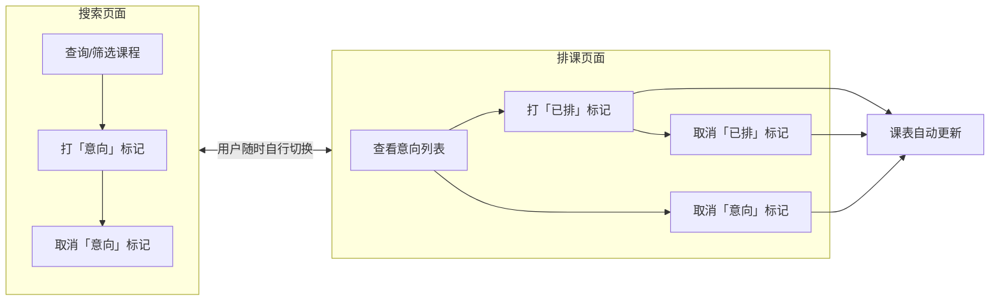
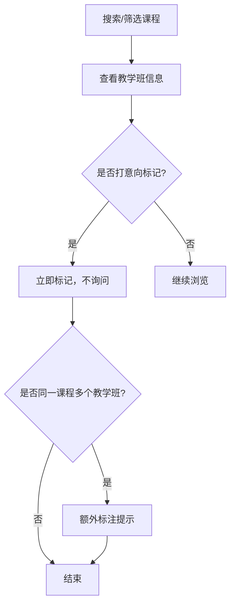
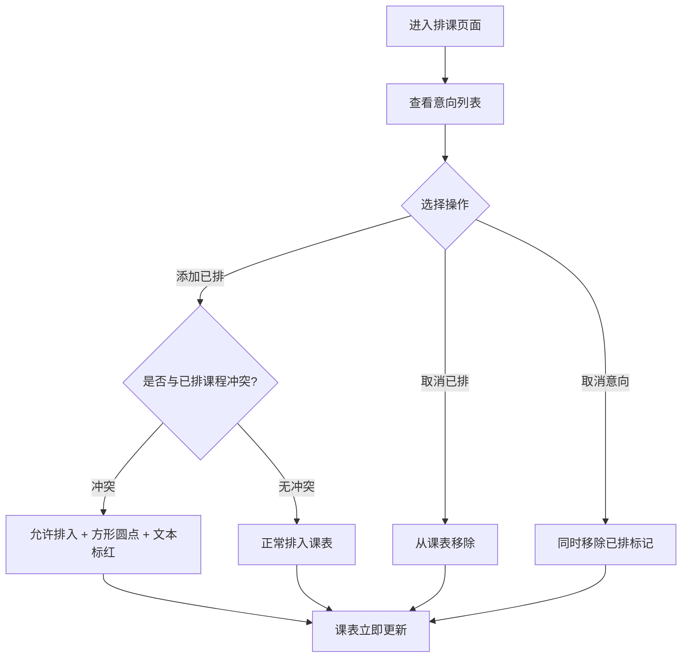
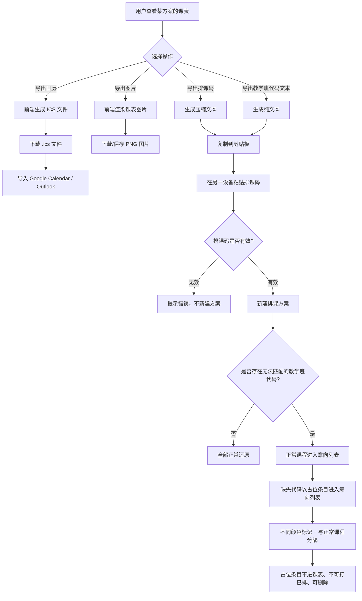
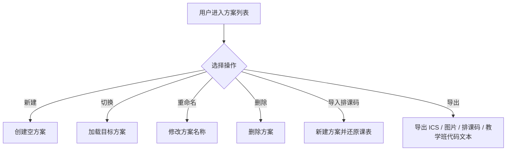

# 课程查询与选课排课系统（course-plus）产品需求文档（PRD）

## 变更记录

| 版本 | 日期 | 作者 | 变更说明 |
| --- | --- | --- | --- |
| v0.1 | 2026-08-26 | - | 初稿创建 |
| v0.2 | 2026-09-07 | Niazye | 新增“变更记录”章节 |
| v0.3 | 2026-09-13 | Niazye | 新增导出图片、设备间互通（排课代码导入/导出）、本硕课程区分、课程大纲超链接四项功能 |
| v0.3.1 | 2026-09-14 | Niazye | 搜索条件增加“备注栏”搜索 |
| v1.0 | 2026-09-15 | Niazye | 由agent依据需求澄清结果补全全部待确认项，形成完整版 PRD |
| v1.1 | 2026-09-16 | Niazye | 引入「意向/已排」两级标记模型；排序固定为教学班代码升序；学分改为「总学时/学分」；培养层次新增「辅修、微专业」；统一导入导出操作；补充教学班字段 |
| v1.2 | 2026-09-16 | Niazye | 筛选与展示字段分离；取消 JSON 导入导出，改为教学班代码文本；导出统一走剪贴板；明确双页面模型与即时响应；筛选选项改为自动适应 |
| v1.3 | 2026-09-17 | Niazye | 明确数据存储边界：课程数据存后端数据库，用户数据（方案/标记）仅存浏览器本地；删除 `plans`/`marks` 表；明确后端 API 为只读查询服务 |
| v1.4 | 2026-09-17 | Niazye | 新增排课页意向列表（含课程名与课程代码）；导入时无法匹配的教学班代码以占位条目进入列表，不同颜色标记并与正常课程分隔，不进课表、不可打已排、可删除 |

| 项目名称 | 课程查询与选课排课系统（course-plus） |
| --- | --- |
| 文档版本 | v1.4 |
| 编写日期 | 2026-08-26 |
| 文档状态 | 完整版，待评审 |
| 目标读者 | 产品、设计、前后端开发、测试 |

---

## 1. 项目背景与目标

### 1.1 背景
学生在每学期选课时，通常需要面对大量课程信息，手动筛选、记录并规划课表，过程繁琐且容易出错。现有选课系统往往只提供简单的课程列表，缺乏高效筛选、冲突检查和日历导出能力，导致学生选课体验不佳。

### 1.2 产品目标
构建一个帮助用户**查询课程、管理选课、生成可视化课表**的 Web 应用，核心价值在于：

1. **高效查询**：快速定位感兴趣的课程，并可直接跳转学校网站查看课程大纲。
2. **两级标记式选排课**：先在「搜索」页用**意向标记**圈定候选课程，再在「排课」页用**已排标记**确定最终课表，选课与排课解耦。
3. **直观排课**：根据已排课程自动生成周课表，并支持按周查看。
4. **统一导出**：将课表导出为 ICS 文件、图片、排课码或教学班代码文本，导入主流日历应用或直接浏览分享。
5. **跨设备互通**：通过排课码在设备间导入/导出课表数据。

### 1.3 核心概念：两级标记
本系统用**两级标记**替代传统的「选课」单一动作，将「想上什么课」与「最终排什么课」分离：

| 标记 | 名称 | 操作位置 | 含义 | 是否进入课表 |
| --- | --- | --- | --- | --- |
| 一级标记 | **意向** | 「搜索」页面 | 选上这个课（候选） | 否 |
| 二级标记 | **已排** | 「排课」页面 | 排上这个课（确定） | **是** |

- **意向**：在搜索页对任意教学班打标，表示「我考虑上这门课」。此阶段**完全无视时间冲突**。
- **已排**：在排课页对**已打意向标记**的教学班打标，表示「这门课进入我的课表」。只有已排的教学班才会出现在课表中。
- 两级标记的详细规则见 3.2 与 3.3。

### 1.4 成功指标（暂定）
> 以下指标为暂定值，保留随时修改的能力。

- 课程查询响应时间 < 500ms。
- 意向/已排标记操作（增/删）即时反馈。
- 课表生成准确率 100%（无冲突遗漏）。
- ICS 文件可被 Google Calendar / Outlook 正常导入。
- 导出的课表图片清晰可读，主流图片格式可正常打开。
- 排课码可在不同设备间成功导入并完整还原课表。

---

## 2. 用户角色

| 角色 | 描述 | 核心诉求 |
| --- | --- | --- |
| **普通用户（学生）** | 查询课程、标记意向、排定课表、导出日历 | 快速找到课程、避免时间冲突、方便导出 |

**说明**：
- 本系统**不设管理员角色**。所有用户权限相同。
- 本系统**不设登录/注册**，无账号体系。
- **用户数据（排课方案、标记）完全存储在浏览器本地**，不上传、不落库、不在设备间自动同步。
- 本系统定位为**轻量网页工具**，不引入账号、权限、云端同步等与核心用途无关的冗余特性。
- 跨设备转移数据**仅通过排课码手动完成**（见 3.4.4、3.4.6）。

---

## 3. 功能需求

### 3.1 课程查询

#### 3.1.1 关键词搜索
- 关键词**匹配所有含文本的字段**（如课程名称、课程代码、教学班代码、教师姓名、备注、地点等）。
- 采用模糊匹配。

#### 3.1.2 筛选条件
- 筛选条件**尽可能全面**，覆盖课程数据中所有可枚举/可比较的字段。
- 至少包括：课程类型、课程性质、开课部门、总学时/学分、上课时间（星期/节次）、上课地点、授课教师、培养层次、周次等。
- 筛选条件保留随时增删的能力。

> **筛选与展示分离**：课程类型、课程性质、开课部门**仅作为筛选/搜索项**，**不在结果中展示**，以避免信息冗余。

#### 3.1.3 排序
- **固定按教学班代码升序排列**。
- **不提供自定义排序**（不支持按其他列排序，也不支持升降序切换）。

#### 3.1.4 结果展示
- 以列表形式展示课程卡片/表格行，包含以下字段：
  - 教学班代码
  - 课程代码
  - 课程名称
  - **总学时/学分**（两个数据在数据结构上分开存储，展示时合并为 `aa/b` 形式，如 `48/3`）
  - 教师
  - 上课时间
  - 上课地点
  - 周次
  - 培养层次
  - 教学组成
  - 备注
- **不展示**以下字段：
  - 课程类型、课程性质、开课部门（仅用于筛选，见 3.1.2）
  - 选课人数、容量、剩余名额等实时选课情况字段（原因见 3.1.6）
- 字段清单保留随时修改的能力。

#### 3.1.5 课程大纲跳转
- 课程卡片/详情页提供超链接，可跳转至学校网站对应的课程大纲页面。
- 链接地址：`https://byyt.ecnu.edu.cn/student/for-std/lesson-search/teaching-syllabus-zh/page/form/`
- **拼接规则**：在上述 URL 后连接**标识课程的六位数字参数**（**路径参数**）。
  - 该参数在爬取到的原始数据中字段名为 **`id`**，是爬取的课程数据的一部分。
  - 该参数**不同于课程代码**，二者**毫无关联**。
- 访问课程大纲页面**需要登录学校统一身份认证**，跳转后由学校网站自行处理登录。
- 因学校方面原因导致的链接失效，本系统**不做处理**。

#### 3.1.6 关于选课情况字段的说明
排课网站仅用于**规划排课**，实际选课情况基于实时数据，不适合在本系统中展示，因此不提供选课人数、容量、剩余名额等字段。

#### 3.1.7 意向标记（一级标记）
- 在搜索结果中，用户可对任意教学班打**意向标记**，表示「选上这个课」。
- **此阶段完全无视时间冲突**，任何教学班均可被打上意向标记。
- 意向标记是二级标记（已排）的前提。
- 搜索页面可看到教学班的**已排标记状态**（只读展示）。
- 标记操作**直接响应，不弹出确认询问**（详见 3.2.2）。

### 3.2 页面模型与标记交互

#### 3.2.1 双页面结构
本系统由**两个页面**构成，用户可**随时自行切换**：

| 页面 | 职责 | 可操作的标记 |
| --- | --- | --- |
| **搜索** | 查询、筛选课程；打意向标记 | 意向（增/删） |
| **排课** | 查看课表；确定最终排课 | 已排（增/删）、意向（仅删） |

#### 3.2.2 即时响应原则
- 用户的**所有标记操作均直接响应**，**不弹出确认询问**。
- 标记后界面与课表**立即更新**。

#### 3.2.3 标记粒度
- 用户以**教学班（平行班）**为单位打标记。
- 教学班之间在逻辑上相当于不同课程（3.2.6 除外）。

#### 3.2.4 意向标记（一级标记）
- **含义**：选上这个课（候选）。
- **操作位置**：「搜索」页面。
- **无视时间冲突**：无论是否与已有意向/已排课程冲突，均可添加。
- **不进入课表**。
- 意向标记是已排标记的前提。

#### 3.2.5 已排标记（二级标记）
- **含义**：排上这个课（确定）。
- **操作位置**：**有且只有「排课」页面**可以操作已排标记。
- 排课页面可对**已打意向标记**的教学班**添加或取消**已排标记。
- **只有已排标记的教学班才会进入课表**。

#### 3.2.6 同一课程多教学班提示
- 若用户对**同一课程的多个教学班**打了标记，系统需**单独、额外标注提示**。
- 该提示**不影响交互**，仅起提示作用。

#### 3.2.7 标记的依赖与联动
- 排课页面**只允许去除已有的一级标记（意向），不允许添加意向**。
- **移除意向时，一并移除该教学班的已排标记**（已排是意向的子集）。
- 搜索页面可看到教学班的**已排标记状态**（只读展示）。

#### 3.2.8 排课页面的意向列表
- 排课页面提供一个**意向列表**，列出当前方案中所有已打意向标记的教学班。
- 列表条目**至少包含课程名称与课程代码**。
- 用户可在该列表中直接对条目**添加/取消已排标记**，或**移除意向标记**。

**缺失课程的占位条目**
- 当导入的排课码中包含**当前数据中不存在的教学班代码**时，这些代码以**占位条目**形式进入意向列表。
- 占位条目**仅展示教学班代码**（无课程名称等其余信息）。
- 占位条目使用**不同颜色的文本**标记，并在列表中与正常课程**直接分隔**（仅当存在此类条目时），同时附加文字（可以在分隔处、列表末尾等位置）。
- 占位条目**可被删除**（移除意向），但**不能被打「已排」标记**。
- 占位条目**不进入课表**，仅在列表中展示。
- 占位条目**仅可能由导入产生**。

### 3.3 排课表

#### 3.3.1 自动生成
- 根据已排教学班自动生成一周课表（周一至周日 × 节次）。
- 课程的具体时间**基于实际学校安排，不允许任意修改**。
- 用户**只有标记/取消标记的功能**，不提供手动调整课表位置的能力。

#### 3.3.2 冲突检测与展示
- 冲突判定规则：**按周次 + 节次**判定（详见 3.6.4）。
- **冲突时允许排入**，不做阻止。
- 冲突的视觉表现：
  - 在周次表示的小圆点中，**将圆形改为方形**。
  - 同时将**冲突课程的文本标红**。

#### 3.3.3 周次展示
- 在课表单元格内使用**数个小圆点**表示周次：
  - 有课的周次：**颜色填充**。
  - 无课的周次：**无填充、描线**。
  - 冲突的周次：**形状改为方形**（见 3.3.2）。
- 提供**按周查看**功能（如仅查看第 N 周的课表）。

### 3.4 导出与导入

本系统将 ICS、图片、排课码、教学班代码文本四类输出统一为**导出操作**；导入**仅支持排课码**。

#### 3.4.1 导出操作总览

| 导出类型 | 形式 | 用途 |
| --- | --- | --- |
| **导出日历** | `.ics` 文件 | 导入 Google Calendar / Outlook 等 |
| **导出图片** | `.png` 文件 | 浏览、查看、分享 |
| **导出排课码** | 压缩文本（**剪贴板**） | 跨设备转移、备份 |
| **导出教学班代码文本** | 纯文本（**剪贴板**） | 快速查看、手动记录 |

> **导出方式**：排课码与教学班代码文本均通过**剪贴板**导出，**不生成文件**。

#### 3.4.2 导出日历（ICS）
- 将当前课表导出为 `.ics` 文件，由**前端生成**。
- **事件粒度**：同一教学班必须保证是**重复事件（RRULE）**，而非多个独立事件。
- **事件标题**：仅包含**课程名**。
- **可选项**：提供导出可选项（如是否包含教师、地点等）。
- **兼容性**：生成的 ICS 文件可导入 Google Calendar、Outlook、Apple Calendar 等主流日历应用。

#### 3.4.3 导出图片
- 将排好的课表以 **PNG** 图片形式导出。
- **固定内容**：周次信息、方案名称。
- **自定义选项**：
  - 课表表格大小
  - 尺寸
  - 是否包含周末
  - 周次信息
  - **是否包含教师**
  - **是否包含地点**
- 自定义选项保留随时添加的能力。

#### 3.4.4 导出排课码
- **内容**：当前方案课表数据的**压缩文本**（仅包含教学班，不含方案名称、创建时间等元数据）。
- **方式**：复制到**剪贴板**。
- **用途**：跨设备转移与备份。

#### 3.4.5 导出教学班代码文本
- **内容**：由**所有已选教学班代码排列得到的纯文本**。
- **方式**：复制到**剪贴板**。
- **用途**：快速查看、手动记录。
- **说明**：该文本**不可用于导入**，仅作展示与记录之用。

#### 3.4.6 导入操作
- **仅支持导入排课码**（不支持导入 ICS、图片或教学班代码文本）。
- **导入行为**：导入时**新建一个排课方案**。
- **使用方式**：通过设备间导出 → 剪贴板复制粘贴 → 导入的方式实现跨设备同步，无需账号登录。
- **缺失课程的处理**：若排课码中包含**当前数据中不存在的教学班代码**，则：
  - 能匹配到的教学班**正常导入**；
  - 无法匹配的代码以**占位条目**形式导入，仅展示代码，并在意向列表中**以不同颜色标记、与正常课程分隔**（详见 3.2.8）；
  - 占位条目**不进入课表**，**不能打「已排」标记**，但**可被删除**。

### 3.5 排课方案管理

- 一个用户可以保存**多个排课方案**。
- 方案支持：**自由切换、修改、命名、查看**。
- 方案之间**不需要交互**；单个方案提供所有常见的交互。
- 方案的导出与导入见 3.4。

### 3.6 时间与周次规则

#### 3.6.1 学期周数
- 学期周数**不固定**，可能为任意周数。
- 系统需**保证兼容性**，不硬编码具体周数（如 16/17/18 周）。

#### 3.6.2 课程周次
- 课程可能**从任意周开始**、**在任意周间断（休息）**、**在任意周结束**。
- 可能存在**仅单周**或**仅双周**上课的课程。

#### 3.6.3 节次定义
- 每天共 **14 节次**，所有节次均持续 **45 分钟**。
- 各节次起始时间如下：

| 节次 | 起始时间 | 结束时间 |
| --- | --- | --- |
| 第 1 节 | 08:00 | 08:45 |
| 第 2 节 | 08:50 | 09:35 |
| 第 3 节 | 09:50 | 10:35 |
| 第 4 节 | 10:40 | 11:25 |
| 第 5 节 | 11:30 | 12:15 |
| 第 6 节 | 13:00 | 13:45 |
| 第 7 节 | 13:50 | 14:35 |
| 第 8 节 | 14:50 | 15:35 |
| 第 9 节 | 15:40 | 16:25 |
| 第 10 节 | 16:30 | 17:15 |
| 第 11 节 | 18:00 | 18:45 |
| 第 12 节 | 18:50 | 19:35 |
| 第 13 节 | 19:40 | 20:25 |
| 第 14 节 | 20:30 | 21:15 |

#### 3.6.4 冲突判定规则
- 冲突判定依据：**周次 + 节次**。
- 判定粒度：**教学班**。
- 判定逻辑：两个教学班在**同一星期几**、**节次区间有交集**、且**周次有交集**时，判定为冲突。
- **适用范围**：冲突仅在**排课阶段（已排标记）**产生意义；意向标记阶段完全无视冲突。

---

## 4. 非功能需求

| 类别 | 需求 |
| --- | --- |
| **性能** | 课程查询接口响应 < 500ms；页面首屏加载 < 2s（暂定） |
| **可用性** | 界面简洁直观，关键操作（选课、导出）不超过 2 步 |
| **兼容性** | 支持主流浏览器：Chrome、Edge、Firefox、Safari、360 浏览器等 |
| **响应式** | 需要响应式适配，支持移动端访问 |
| **可维护性** | 前后端分离，代码结构清晰，便于扩展 |
| **隐私** | 网站本身、网站前后端之间**不申请、不转发任何个人信息**；用户数据不出浏览器 |
| **数据持久性** | 用户数据（方案/标记）以浏览器本地存储方式持久化，保证基本的持久性与完整性；清除浏览器数据会导致用户数据丢失，需提示用户通过排课码备份 |
| **部署** | 自建服务器部署 |

---

## 5. 关键业务流程

### 5.1 双页面与标记总览

### 5.2 意向标记流程（搜索页）

### 5.3 已排标记与冲突处理流程（排课页）

### 5.4 导出与导入流程

### 5.5 排课方案管理流程

---

## 6. 数据模型（草案）

### 6.1 数据层级说明
- 数据以**教学班（平行班）**为**最大单位**。
- **不单独分级**：不建立独立的课程层级表。所有属于「课程」的信息（包括但不限于课程类型、课程性质、开课部门、学分、总学时等）**均在教学班信息中存在**。
- 不同课程仅通过教学班内的字段标识（如课程代码），不单独建表。

### 6.2 教学班字段清单

| 字段 | 说明 |
| --- | --- |
| 教学班代码 | 教学班的唯一标识，**默认排序依据** |
| 课程代码 | 课程标识（与课程大纲的 `id` 参数无关） |
| 课程名称 | 课程名称 |
| 总学时 | 与学分分开存储 |
| 学分 | 与总学时分开存储；展示时合并为 `总学时/学分` |
| 教师 | 授课教师 |
| 上课时间 | 星期 + 节次 |
| 上课地点 | 上课地点 |
| 周次 | 实际开课周，可能不连续 |
| 培养层次 | 见 6.4 |
| 课程类型 | 仅用于筛选，不在结果中展示（见 3.1.2） |
| 课程性质 | 仅用于筛选，不在结果中展示（见 3.1.2） |
| 开课部门 | 仅用于筛选，不在结果中展示（见 3.1.2） |
| 教学组成 | 某年级某学期某班级（学校原始数据的一部分，形式不确定） |
| 备注 | 课程/教学班的字段之一 |
| 课程大纲链接 | 由课程 `id` 参数拼接得到（见 3.1.5） |

> 字段清单保留随时修改的能力，具体字段以设计阶段为准。

### 6.3 数据存储

本系统的数据按**存储位置**分为两类，边界必须严格区分：

| 数据类别 | 内容 | 存储位置 | 读写方式 |
| --- | --- | --- | --- |
| **课程数据** | 教学班信息（含全部课程信息） | **后端数据库** | 爬虫全量替换写入；前端只读查询 |
| **用户数据** | 排课方案、意向/已排标记 | **浏览器本地存储** | 前端读写；后端不参与、不感知 |

#### 6.3.1 课程数据表

| 表名 | 主要字段 | 说明 |
| --- | --- | --- |
| `teaching_classes` | id, class_code, course_code, course_name, total_hours, credits, teacher, location, schedule, weeks, level, course_type, course_nature, department, teaching_composition, remark, syllabus_url | 教学班信息（含全部课程信息） |

> 课程数据**只有这一张表**，由爬虫全量替换维护（见 7.2）。

#### 6.3.2 用户数据

- 用户数据（方案、标记）**不建表、不入库**，完全存储在**浏览器本地**。
- 后端**不提供**方案/标记的读写接口，也**不保存**任何用户数据。
- 用户数据的具体本地存储形式（如 IndexedDB / localStorage）由设计阶段确定。
- 用户数据的**跨设备转移**只能通过排课码手动完成（见 3.4.4、3.4.6）。

> **说明**：
> - 本系统**无用户表**（不需要登录）。
> - 方案**不再需要收藏标记**字段。

### 6.4 培养层次说明
- 培养层次**不是数据中的独立字段**，不同培养层次的数据**本身就是分开的**。
- 培养层次的区分方式为：**数据来源分离**，而非字段筛选。
- 共 **3 个平行等价的层次**，表现完全相同：

| 培养层次 | 说明 |
| --- | --- |
| **本科生** | 数据来源之一 |
| **研究生** | 数据来源之一 |
| **辅修、微专业** | 数据来源之一 |

### 6.5 筛选字段的自动适应
- 课程类型、课程性质、开课部门等字段的**可选值不手动维护**。
- 筛选/搜索项**根据数据中实际存在的字段值自动适应**（动态生成选项）。
- 因此**无需预先枚举取值**，新增数据中的新取值会自动出现在筛选项中。

---

## 7. 数据来源与爬取

### 7.1 数据来源
- 课程数据通过**爬取学校网站**获取。
- 目标站点：`https://byyt.ecnu.edu.cn/student/for-std/lesson-search/search/`
- **学期参数**：上述 URL 后需连接**标识学期的六位数字参数**（**路径参数**）。
  - 参数的具体原理未知。
  - 需**手动获取**该参数，并在**爬虫脚本中记录**。
  - 参数名未知，本文档不列出具体值。

### 7.2 爬取方式
- 爬取由**独立脚本**完成，学期范围由脚本决定。
- 爬虫使用**浏览器中的 Cookie** 携带登录信息访问学校网站。
- **Cookie 手动获取**。
- 爬取频率**灵活设定**（默认每天一次）。
- 更新方式：**全量替换**。
- 爬取时需一并获取课程大纲所需的 **`id` 参数**（见 3.1.5）。

### 7.3 学期支持
- 系统**支持多学期**。
- 用户**随时可以切换查看**不同学期的课程数据。

### 7.4 合规说明
- 本系统**仅用于个人学习使用，风险自担**。
- 使用者需自行确保爬取行为符合学校相关规定。

---

## 8. 技术选型（待设计阶段确认）

| 层 | 候选方案 | 说明 |
| --- | --- | --- |
| **后端** | Rust（axum/actix）或 Node.js/TypeScript | 高性能、类型安全；**仅提供课程数据的只读查询接口** |
| **前端** | React / Vue / Svelte（待定） | 组件化、生态成熟 |
| **数据库** | SQLite（已确定） | 关系型，适合结构化课程数据；**仅存课程数据** |
| **用户数据存储** | 浏览器本地（已确定） | 方案/标记存本地，不入库（见 6.3.2） |
| **ICS 生成** | 前端生成（已确定） | 浏览器内生成并下载 |
| **图片导出** | 前端 Canvas/SVG 渲染（已确定） | 生成 PNG |
| **排课码** | 压缩文本（已确定） | 通过剪贴板导出，用于设备间导入 |

> 技术选型保持待定，由设计阶段确定。

---

## 9. 里程碑规划

| 阶段 | 内容 | 交付物 |
| --- | --- | --- |
| **M1 需求确认** | 确认角色、功能范围、冲突规则 | 定稿 PRD |
| **M2 设计** | 技术栈、API 设计、数据库设计 | 设计文档、架构图 |
| **M3 开发** | 前后端开发 | 可运行系统 |
| **M4 测试** | 单元/集成/端到端测试 | 测试报告 |
| **M5 验收** | 功能验收、部署 | 验收清单、部署文档 |

> 里程碑**不设截止时间**。

---

## 10. 待确认问题清单

1. 学期六位数字参数的具体原理（参数名未知，需手动获取并记录在爬虫脚本中）。
2. 课程字段清单的最终确定（保留随时修改的能力）。
3. 筛选条件的最终确定（保留随时更改的能力）。
4. 导出图片自定义选项的最终确定（保留随时添加的能力）。
5. 成功指标的最终确定（暂定，保留随时修改的能力）。
6. 技术选型的最终确定（待设计阶段）。
7. 爬取脚本的学期范围与频率设定（由脚本决定，灵活设定）。
8. 排课码压缩格式的具体算法（待设计阶段）。
9. 用户数据本地存储的具体选型（IndexedDB / localStorage 等，待设计阶段）。
10. 「教学组成」字段的具体形式（学校原始数据的一部分，形式不确定）。

---

## 11. 附录

### 11.1 术语表
| 术语 | 含义 |
| --- | --- |
| ICS | iCalendar 文件格式，用于日历数据交换 |
| 节次 | 一天中划分的固定上课时间段，本系统每天 14 节次，每节 45 分钟 |
| 教学班 | 课程的具体开课班级，是数据、标记与冲突判定的**最大单位** |
| 平行班 | 同一课程下的不同教学班，逻辑上相当于不同课程 |
| 意向（一级标记） | 在「搜索」页面标记「选上这个课」，无视冲突，不进入课表 |
| 已排（二级标记） | 在「排课」页面标记「排上这个课」，进入课表，参与冲突检测 |
| 培养层次 | 课程所属的学历阶段，共 3 个平行层次：本科生、研究生、辅修、微专业（数据来源分离） |
| 排课码 | 课表数据的**压缩文本**，通过剪贴板导出，用于跨设备转移与备份 |
| 教学班代码文本 | 由所有已选教学班代码排列得到的纯文本，仅用于查看与记录，不可导入 |
| 意向列表 | 排课页面中列出所有已打意向标记教学班的列表，含课程名称与课程代码 |
| 占位条目 | 导入时无法匹配到当前数据的教学班代码，在意向列表中仅展示代码，以不同颜色标记并与正常课程分隔 |
| 排课方案 | 用户保存的一套课表数据，可命名、切换、导入导出 |
| 课程大纲 | 学校网站提供的课程教学大纲页面，由课程 `id` 参数拼接访问 |
| 周次 | 课程在一学期中实际开课的周，可能不连续 |
| 教学组成 | 学校原始数据字段，表示某年级某学期某班级 |

### 11.2 参考
- [iCalendar 规范 (RFC 5545)](https://datatracker.ietf.org/doc/html/rfc5545)
- 学校课程查询站点：`https://byyt.ecnu.edu.cn/student/for-std/lesson-search/search/`（需连接学期六位数字路径参数）
- 学校课程大纲站点：`https://byyt.ecnu.edu.cn/student/for-std/lesson-search/teaching-syllabus-zh/page/form/`（需连接课程 `id` 路径参数）
