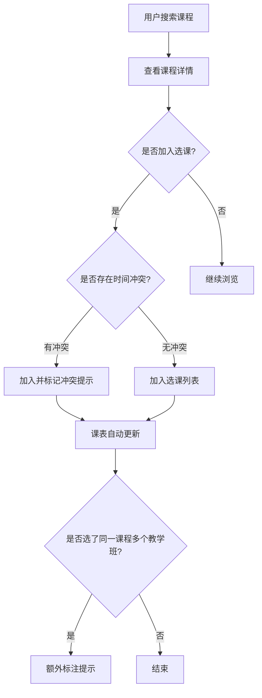
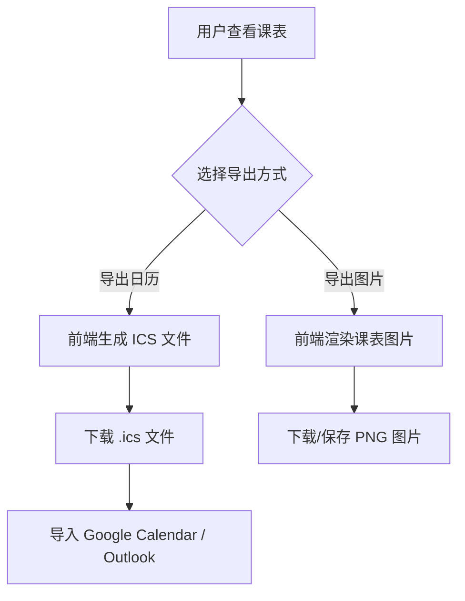
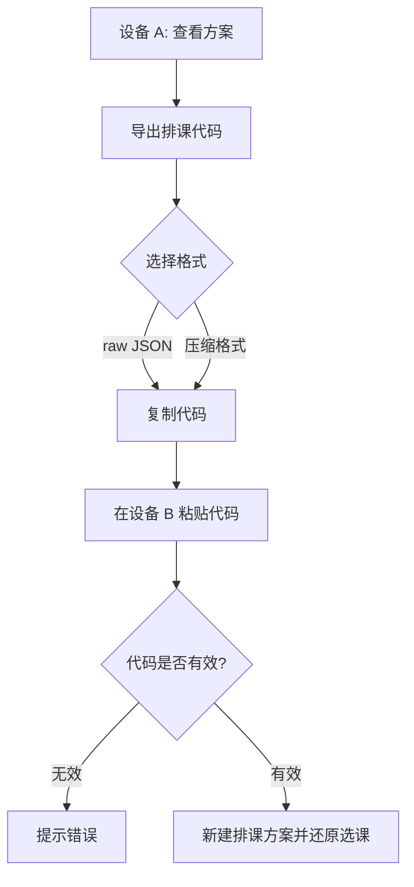
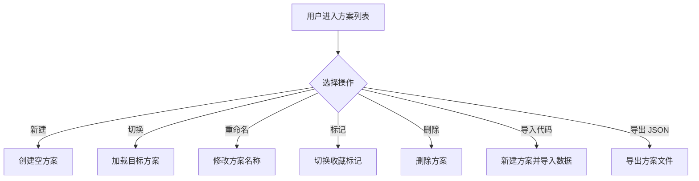

# 课程查询与选课排课系统（course-plus）产品需求文档（PRD）

## 变更记录

| 版本 | 日期 | 作者 | 变更说明 |
| --- | --- | --- | --- |
| v0.1 | 2026-08-26 | - | 初稿创建 |
| v0.2 | 2026-09-07 | Niazye | 新增“变更记录”章节 |
| v0.3 | 2026-09-13 | Niazye | 新增导出图片、设备间互通（排课代码导入/导出）、本硕课程区分、课程大纲超链接四项功能 |
| v0.3.1 | 2026-09-14 | Niazye | 搜索条件增加“备注栏”搜索 |
| v1.0 | 2026-09-15 | Niazye | 由agent依据需求澄清结果补全全部待确认项，形成完整版 PRD |

| 项目名称 | 课程查询与选课排课系统（course-plus） |
| --- | --- |
| 文档版本 | v1.0 |
| 编写日期 | 2026-08-26 |
| 文档状态 | 完整版，待评审 |
| 目标读者 | 产品、设计、前后端开发、测试 |

---

## 1. 项目背景与目标

### 1.1 背景
学生在每学期选课时，通常需要面对大量课程信息，手动筛选、记录并规划课表，过程繁琐且容易出错。现有选课系统往往只提供简单的课程列表，缺乏高效筛选、冲突检查和日历导出能力，导致学生选课体验不佳。

### 1.2 产品目标
构建一个帮助用户**查询课程、管理选课、生成可视化课表**的 Web 应用，核心价值在于：

1. **高效查询**：快速定位感兴趣的课程，并可直接跳转学校网站查看课程大纲。
2. **便捷管理**：集中管理个人选课列表，支持多套排课方案。
3. **直观排课**：根据选课结果自动生成周课表，并支持按周查看。
4. **无缝导出**：将课表导出为 ICS 文件或图片，导入主流日历应用或直接浏览分享。
5. **跨设备互通**：通过排课代码在设备间导入/导出选课与课表数据。

### 1.3 成功指标（暂定）
> 以下指标为暂定值，保留随时修改的能力。

- 课程查询响应时间 < 500ms。
- 选课列表操作（增/删）即时反馈。
- 课表生成准确率 100%（无冲突遗漏）。
- ICS 文件可被 Google Calendar / Outlook 正常导入。
- 导出的课表图片清晰可读，主流图片格式可正常打开。
- 排课代码可在不同设备间成功导入并完整还原选课与课表。

---

## 2. 用户角色

| 角色 | 描述 | 核心诉求 |
| --- | --- | --- |
| **普通用户（学生）** | 查询课程、选课、查看课表、导出日历 | 快速找到课程、避免时间冲突、方便导出 |

**说明**：
- 本系统**不设管理员角色**。所有用户权限相同。
- 本系统**不设登录/注册**，无账号体系。用户数据完全存储在本地。

---

## 3. 功能需求

### 3.1 课程查询

#### 3.1.1 关键词搜索
- 关键词**匹配所有含文本的字段**（如课程名称、课程代码、教学班代码、教师姓名、备注、地点等）。
- 采用模糊匹配。

#### 3.1.2 筛选条件
- 筛选条件**尽可能全面**，覆盖课程数据中所有可枚举/可比较的字段。
- 至少包括：课程分类、学分、上课时间（星期/节次）、上课地点、授课教师、培养层次、周次等。
- 筛选条件保留随时增删的能力。

#### 3.1.3 排序
- 支持**以任意列排序**（升序/降序）。
- 排序规则保留随时更改的能力。

#### 3.1.4 结果展示
- 以列表形式展示课程卡片/表格行，包含以下字段：
  - 课程代码
  - 课程名称
  - 学分
  - 教师
  - 上课时间
  - 上课地点
  - 培养层次
  - 备注
  - 课程分类
- **不展示**选课人数、容量、剩余名额等实时选课情况字段（原因见 3.1.6）。
- 字段清单保留随时修改的能力。

#### 3.1.5 课程大纲跳转
- 课程卡片/详情页提供超链接，可跳转至学校网站对应的课程大纲页面。
- 链接地址：`https://byyt.ecnu.edu.cn/student/for-std/lesson-search/teaching-syllabus-zh/page/form/`
- 该链接**似乎可由参数拼接得到**（具体拼接规则待设计阶段验证）。
- 访问课程大纲页面**需要登录学校统一身份认证**，跳转后由学校网站自行处理登录。
- 因学校方面原因导致的链接失效，本系统**不做处理**。

#### 3.1.6 关于选课情况字段的说明
排课网站仅用于**规划排课**，实际选课情况基于实时数据，不适合在本系统中展示，因此不提供选课人数、容量、剩余名额等字段。

### 3.2 选课管理

#### 3.2.1 选课粒度
- 用户选课**以教学班（平行班）为单位**。
- 教学班之间在逻辑上相当于不同课程。

#### 3.2.2 加入选课
- 将教学班加入当前排课方案。

#### 3.2.3 移除选课
- 从当前排课方案中移除教学班。

#### 3.2.4 冲突提示
- 加入教学班时，若与已有选课存在时间冲突，**允许加入**，但给出**特殊标记/提示**。
- 冲突判定以**教学班为最小单位**，逻辑与不同课程之间的冲突一致。

#### 3.2.5 同一课程多教学班提示
- 若用户选择了**同一课程的多个教学班**，系统需**单独、额外标注提示**。
- 该提示**不影响交互**，仅起提示作用。

#### 3.2.6 选课列表
- 集中展示当前方案已选的教学班，支持增删操作。

### 3.3 排课表

#### 3.3.1 自动生成
- 根据已选教学班自动生成一周课表（周一至周日 × 节次）。
- 课程的具体时间**基于实际学校安排，不允许任意修改**。
- 用户**只有选/不选课的功能**，不提供手动调整课表位置的能力。

#### 3.3.2 冲突检测
- 自动检测并高亮时间冲突的教学班。
- 冲突判定规则：**按周次 + 节次**判定（详见 3.7）。

#### 3.3.3 周次展示
- 在课表单元格内使用**数个小圆点**表示周次：
  - 有课的周次：**颜色填充**。
  - 无课的周次：**无填充、描线**。
- 提供**按周查看**功能（如仅查看第 N 周的课表）。

### 3.4 导出日历（ICS）

- **ICS 导出**：将当前课表导出为 `.ics` 文件。
- **生成位置**：由**前端生成**。
- **事件粒度**：同一教学班必须保证是**重复事件（RRULE）**，而非多个独立事件。
- **事件标题**：仅包含**课程名**。
- **可选项**：提供导出可选项（如是否包含教师、地点等）。
- **兼容性**：生成的 ICS 文件可导入 Google Calendar、Outlook、Apple Calendar 等主流日历应用。

### 3.5 导出图片

- **图片导出**：将排好的课表以图片形式导出，便于浏览、查看与分享。
- **格式**：**PNG**。
- **内容**：包含教师、地点、周次信息、方案名称。
- **自定义选项**：
  - 课表表格大小
  - 尺寸
  - 是否包含周末
  - 周次信息
- 自定义选项保留随时添加的能力。

### 3.6 设备间互通（排课代码）

- **导出排课代码**：将当前方案的选课数据导出为一段「排课代码」（文本形式）。
- **导入排课代码**：在另一设备上粘贴并导入该代码，还原选课数据。
- **编码格式**：**同时提供两种导出**
  - **raw JSON**：可读性好，便于查看与调试。
  - **压缩格式**：体积小，便于传输。
  - 两者均可用于转移和备份导入。
- **代码内容**：**仅包含教学班**（不含方案名称、创建时间等元数据）。
- **导入行为**：导入代码时**新建一个排课方案**。
- **使用方式**：通过设备间导出代码 → 复制粘贴 → 导入代码的方式实现跨设备同步，无需账号登录。

### 3.7 排课方案管理

- 一个用户可以保存**多个排课方案**。
- 方案支持：**自由切换、修改、命名、查看、标记**。
- **标记**：指**收藏标记**。
- 方案之间**不需要交互**；单个方案提供所有常见的交互。
- 支持将排课方案的 **JSON 代码导出为文件**。

### 3.8 时间与周次规则

#### 3.8.1 学期周数
- 学期周数可能为 **16、17 或 18 周**。

#### 3.8.2 课程周次
- 课程可能**从任意周开始**、**在任意周间断（休息）**、**在任意周结束**。
- 可能存在**仅单周**或**仅双周**上课的课程。

#### 3.8.3 节次定义
- 每天共 **14 节次**，所有节次均持续 **45 分钟**。
- 各节次起始时间如下：

| 节次 | 起始时间 | 结束时间 |
| --- | --- | --- |
| 第 1 节 | 08:00 | 08:45 |
| 第 2 节 | 08:50 | 09:35 |
| 第 3 节 | 09:50 | 10:35 |
| 第 4 节 | 10:40 | 11:25 |
| 第 5 节 | 11:30 | 12:15 |
| 第 6 节 | 13:00 | 13:45 |
| 第 7 节 | 13:50 | 14:35 |
| 第 8 节 | 14:50 | 15:35 |
| 第 9 节 | 15:40 | 16:25 |
| 第 10 节 | 16:30 | 17:15 |
| 第 11 节 | 18:00 | 18:45 |
| 第 12 节 | 18:50 | 19:35 |
| 第 13 节 | 19:40 | 20:25 |
| 第 14 节 | 20:30 | 21:15 |

> 注：结束时间由「起始时间 + 45 分钟」推算得出，如与学校实际安排不符请以学校为准。

#### 3.8.4 冲突判定规则
- 冲突判定依据：**周次 + 节次**。
- 判定粒度：**教学班**。
- 判定逻辑：两个教学班在**同一星期几**、**节次区间有交集**、且**周次有交集**时，判定为冲突。

---

## 4. 非功能需求

| 类别 | 需求 |
| --- | --- |
| **性能** | 课程查询接口响应 < 500ms；页面首屏加载 < 2s（暂定） |
| **可用性** | 界面简洁直观，关键操作（选课、导出）不超过 2 步 |
| **兼容性** | 支持主流浏览器：Chrome、Edge、Firefox、Safari、360 浏览器等 |
| **响应式** | 需要响应式适配，支持移动端访问 |
| **可维护性** | 前后端分离，代码结构清晰，便于扩展 |
| **隐私** | 网站本身、网站前后端之间**不申请、不转发任何个人信息** |
| **数据持久性** | 本地数据以普通数据存储，保证基本的持久性与完整性 |
| **部署** | 自建服务器部署 |

---

## 5. 关键业务流程

### 5.1 选课流程

### 5.2 课表导出流程

### 5.3 设备间互通流程

### 5.4 排课方案管理流程

---

## 6. 数据模型（草案）

### 6.1 数据层级说明
- 数据以**教学班（平行班）**为基本单位。
- **不单独分级**：不同课程仅通过教学班内的单独字段标识（如课程代码），不建立独立的课程层级表。
- 教学班基本信息包括：**时间、地点、教师、课程代码、教学班代码**。

### 6.2 数据表

| 表名 | 主要字段 | 说明 |
| --- | --- | --- |
| `teaching_classes` | id, course_code, class_code, course_name, credits, teacher, location, schedule, weeks, level, category, remark, syllabus_url | 教学班信息（`level` 为培养层次，`syllabus_url` 为课程大纲链接） |
| `plans` | id, name, starred, created_at, updated_at | 排课方案（`starred` 为收藏标记） |
| `selections` | id, plan_id, teaching_class_id, created_at | 方案内的选课记录 |

> **说明**：
> - 本系统**无用户表**（不需要登录）。
> - 字段清单保留随时修改的能力，具体字段以设计阶段为准。
> - 培养层次**不是数据中的独立字段**，不同培养层次的数据本身就是分开的（详见 6.3）。

### 6.3 培养层次说明
- 数据中**不存在**「培养层次」这样的独立字段。
- 不同培养层次（本科生/研究生）的数据**本身就是分开的**。
- 因此，培养层次的区分方式为：**数据来源分离**，而非字段筛选。

### 6.4 课程分类字段（待填充）
> 以下表格留空，由用户自行填充。

| 分类维度 | 可选值 | 说明 |
| --- | --- | --- |
| （待填充） | （待填充） | （待填充） |
| （待填充） | （待填充） | （待填充） |
| （待填充） | （待填充） | （待填充） |

---

## 7. 数据来源与爬取

### 7.1 数据来源
- 课程数据通过**爬取学校网站**获取。
- 目标站点：`https://byyt.ecnu.edu.cn/student/for-std/lesson-search/search/`

### 7.2 爬取方式
- 爬取由**独立脚本**完成，学期范围由脚本决定。
- 爬虫使用**浏览器中的 Cookie** 携带登录信息访问学校网站。
- **Cookie 手动获取**。
- 爬取频率**灵活设定**（默认每天一次）。
- 更新方式：**全量替换**。

### 7.3 学期支持
- 系统**支持多学期**。
- 用户**随时可以切换查看**不同学期的课程数据。

### 7.4 合规说明
- 本系统**仅用于个人学习使用，风险自担**。
- 使用者需自行确保爬取行为符合学校相关规定。

---

## 8. 技术选型（待设计阶段确认）

| 层 | 候选方案 | 说明 |
| --- | --- | --- |
| **后端** | Rust（axum/actix）或 Node.js/TypeScript | 高性能、类型安全 |
| **前端** | React / Vue / Svelte（待定） | 组件化、生态成熟 |
| **数据库** | PostgreSQL / SQLite（待定） | 关系型，适合结构化课程数据 |
| **ICS 生成** | 前端生成（已确定） | 浏览器内生成并下载 |
| **图片导出** | 前端 Canvas/SVG 渲染（已确定） | 生成 PNG |
| **排课代码** | raw JSON + 压缩格式（已确定） | 用于设备间导入/导出 |

> 技术选型保持待定，由设计阶段确定。

---

## 9. 里程碑规划

| 阶段 | 内容 | 交付物 |
| --- | --- | --- |
| **M1 需求确认** | 确认角色、功能范围、冲突规则 | 定稿 PRD |
| **M2 设计** | 技术栈、API 设计、数据库设计 | 设计文档、架构图 |
| **M3 开发** | 前后端开发 | 可运行系统 |
| **M4 测试** | 单元/集成/端到端测试 | 测试报告 |
| **M5 验收** | 功能验收、部署 | 验收清单、部署文档 |

> 里程碑**不设截止时间**。

---

## 10. 待确认问题清单

1. 课程分类字段的具体维度与取值（见 6.4，待用户填充）。
2. 课程大纲链接的**参数拼接规则**（待设计阶段验证）。
3. 课程字段清单的最终确定（保留随时修改的能力）。
4. 筛选条件与排序规则的最终确定（保留随时更改的能力）。
5. 导出图片自定义选项的最终确定（保留随时添加的能力）。
6. 成功指标的最终确定（暂定，保留随时修改的能力）。
7. 技术选型的最终确定（待设计阶段）。
8. 爬取脚本的学期范围与频率设定（由脚本决定，灵活设定）。
9. 排课代码压缩格式的具体算法（待设计阶段）。
10. 数据持久化方案的具体实现（本地存储选型，待设计阶段）。

---

## 11. 附录

### 11.1 术语表
| 术语 | 含义 |
| --- | --- |
| ICS | iCalendar 文件格式，用于日历数据交换 |
| 节次 | 一天中划分的固定上课时间段，本系统每天 14 节次，每节 45 分钟 |
| 教学班 | 课程的具体开课班级，是选课与冲突判定的最小单位 |
| 平行班 | 同一课程下的不同教学班，逻辑上相当于不同课程 |
| 选课列表 | 用户已选择的教学班集合 |
| 培养层次 | 课程所属的学历阶段，分为本科生课程与研究生课程（数据来源分离） |
| 排课代码 | 用于在设备间导入/导出选课数据的文本编码，支持 raw JSON 与压缩格式 |
| 排课方案 | 用户保存的一套选课与课表数据，可命名、切换、标记、导入导出 |
| 课程大纲 | 学校网站提供的课程教学大纲页面 |
| 周次 | 课程在一学期中实际开课的周，可能不连续 |

### 11.2 参考
- [iCalendar 规范 (RFC 5545)](https://datatracker.ietf.org/doc/html/rfc5545)
- 学校课程查询站点：`https://byyt.ecnu.edu.cn/student/for-std/lesson-search/search/`
- 学校课程大纲站点：`https://byyt.ecnu.edu.cn/student/for-std/lesson-search/teaching-syllabus-zh/page/form/`
