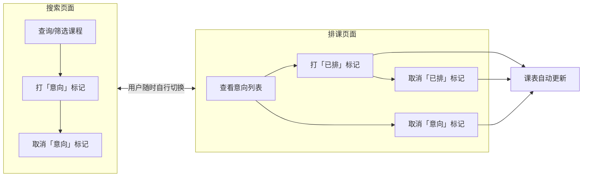
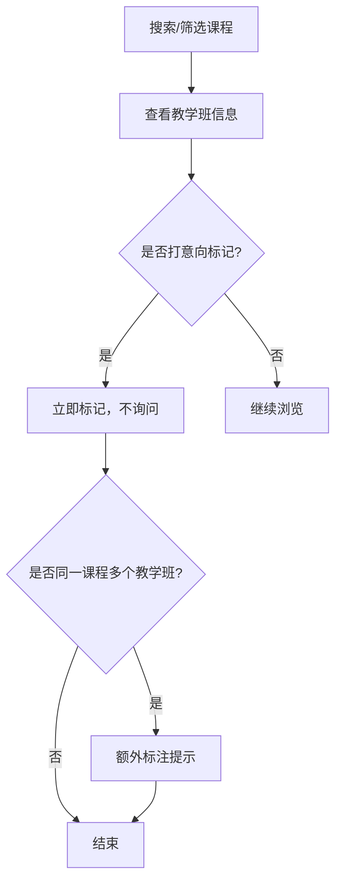
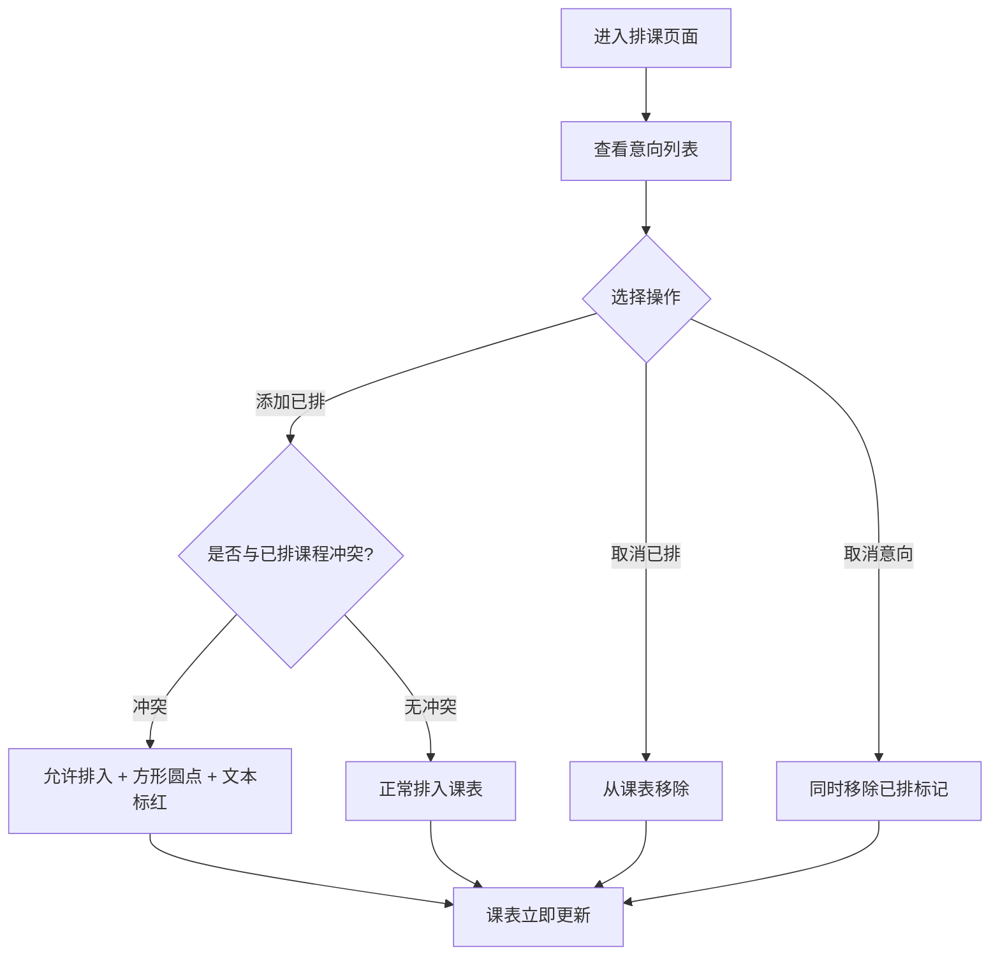
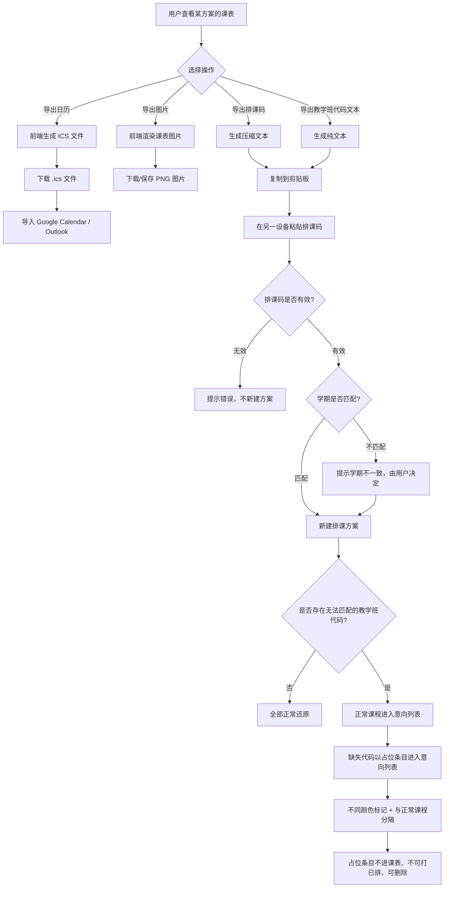
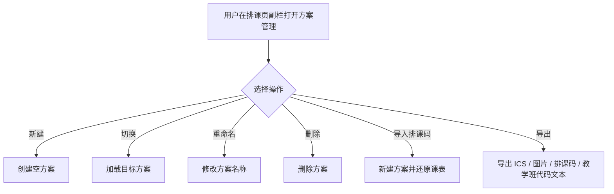

# 课程查询与选课排课系统（Hydrangea）产品需求文档（PRD）

## 变更记录

| 版本 | 日期 | 作者 | 变更说明 |
| --- | --- | --- | --- |
| v1.0 | 2026-09-21 | Niazye | 全新重写。以遗留参考 `PRD-formal.md` 为蓝本，**仅保留关系到用户使用和体验的业务需求**，抛弃数据模型、爬取、里程碑等非业务部分，作为本项目新的权威 PRD |
| v1.1 | 2026-09-21 | Niazye | 评审修订：修正交叉引用编号；删除 §3.2.8 重复的布局小节；明确占位条目仅展示教学班代码；明确教学班代码文本导出仅含已排；明确方案「修改」含方案内容编辑；明确已排不单独设上限；导入遇方案上限时阻止并提示；新增学期切换入口（左侧副栏下拉框）；明确搜索页已排状态在意向列表展示；§6.3 措辞由「爬虫」弱化为「数据更新」 |
| v1.2 | 2026-10-08 | Niazye | 补全「学期区分」设计：新增 §3.2.1 学期标识格式定义（`学年-学期`，如 `2026-2027-1`）；明确教学班代码跨学期会重复、必须以学期区分；新增 §3.6.5 学期规则（学期列表来源、默认学期、学期与课程数据/方案/排课码的关系）；§3.4.4 明确排课码学期标识；§3.5 明确方案学期绑定语义 |
| v1.3 | 2026-10-16 | Niazye | §3.1.2 明确四项筛选条件**均支持多选**：同一项内多值取「或」，不同项之间取「与」，不勾选任何选项表示该项不限 |
| v1.4 | 2026-11-10 | Niazye | §3.6.5 新增「学期与搜索/筛选条件」：搜索关键词与筛选条件**不随学期清空**，切换学期时仍存在的选项保持选中、不存在的取消并隐藏（附提示），分页回到第 1 页 |
| v1.5 | 2026-11-10 | Niazye | §3.6.5 修订条件保留规则：**按学期分别记住**筛选条件，本学期不存在的选中值改为**暂存**（不显示、不生效）而非丢弃，切回对应学期**自动恢复**；条件本地持久化，刷新后可恢复 |

| 项目名称 | 课程查询与选课排课系统（Hydrangea） |
| --- | --- |
| 文档版本 | v1.5 |
| 编写日期 | 2026-09-21 |
| 文档状态 | 完整版，待评审 |
| 目标读者 | 产品、设计、前后端开发、测试 |

> **说明**：本文件为本项目**唯一权威 PRD**。`docs/PRD-formal.md` 仅为遗留参考文档，不作为需求依据。

---

## 1. 项目背景与目标

### 1.1 背景
学生在每学期选课时，通常需要面对大量课程信息，手动筛选、记录并规划课表，过程繁琐且容易出错。现有选课系统往往只提供简单的课程列表，缺乏高效筛选、冲突检查和日历导出能力，导致学生选课体验不佳。

### 1.2 产品目标
构建一个帮助用户**查询课程、管理选课、生成可视化课表**的 Web 应用，核心价值在于：

1. **高效查询**：快速定位感兴趣的课程，并可直接跳转学校网站查看课程大纲。
2. **两级标记式选排课**：先在「搜索」页用**意向标记**圈定候选课程，再在「排课」页用**已排标记**确定最终课表，选课与排课解耦。
3. **直观排课**：根据已排课程自动生成周课表，并支持按周查看。
4. **统一导出**：将课表导出为 ICS 文件、图片、排课码或教学班代码文本，导入主流日历应用或直接浏览分享。
5. **跨设备互通**：通过排课码在设备间导入/导出课表数据。

### 1.3 核心概念：两级标记
本系统用**两级标记**替代传统的「选课」单一动作，将「想上什么课」与「最终排什么课」分离：

| 标记 | 名称 | 操作位置 | 含义 | 是否进入课表 |
| --- | --- | --- | --- | --- |
| 一级标记 | **意向** | 「搜索」页面 | 选上这个课（候选） | 否 |
| 二级标记 | **已排** | 「排课」页面 | 排上这个课（确定） | **是** |

- **意向**：在搜索页对任意教学班打标，表示「我考虑上这门课」。此阶段**完全无视时间冲突**。
- **已排**：在排课页对**已打意向标记**的教学班打标，表示「这门课进入我的课表」。只有已排的教学班才会出现在课表中。
- 两级标记的详细规则见 3.2 与 3.3。

---

## 2. 用户角色

| 角色 | 描述 | 核心诉求 |
| --- | --- | --- |
| **普通用户（学生）** | 查询课程、标记意向、排定课表、导出日历 | 快速找到课程、避免时间冲突、方便导出 |

**说明**：
- 本系统**不设管理员角色**。所有用户权限相同。
- 本系统**不设登录/注册**，无账号体系。
- **用户数据（排课方案、标记）完全存储在浏览器本地**，不上传、不落库、不在设备间自动同步。
- 本系统定位为**轻量网页工具**，不引入账号、权限、云端同步等与核心用途无关的冗余特性。
- 跨设备转移数据**仅通过排课码手动完成**（见 3.4.4、3.4.6）。

---

## 3. 功能需求

### 3.1 课程查询

#### 3.1.1 关键词搜索
- 关键词**匹配所有含文本的字段，但不包括 3.1.2 中定义的筛选条件**（如课程名称、课程代码、教学班代码、教师姓名、备注、地点等）。
- 采用模糊匹配。
- **除四项筛选条件（见 3.1.2）外的所有字段，均只能通过关键词搜索定位**。

#### 3.1.2 筛选条件
- 筛选条件**仅限以下四项**：
  - **课程类型**
  - **课程性质**
  - **开课部门**
  - **培养层次**
- 除上述四项外，**其余字段一律不提供筛选**（包括但不限于教师、总学时/学分、上课时间、上课地点、周次等），这些字段**仅通过关键词搜索**（见 3.1.1）。
- 筛选条件的选项**随数据自动适应**（见 6.2）；**培养层次除外**，其选项**固定为三个**（见 6.1）。
- 四项筛选条件**均支持多选**：
  - **同一项内**选择多个值，取「**或**」——满足其中任一值即命中。
  - **不同项之间**取「**与**」——须同时满足每一已选条件。
  - **不勾选任何选项**表示该项**不限**，等同未使用该筛选。

> **筛选与展示分离**：课程类型、课程性质、开课部门**仅作为筛选项**，**不在结果中展示**，以避免信息冗余。培养层次**在结果中展示**（见 3.1.4）。

#### 3.1.3 排序
- **固定按教学班代码升序排列**。
- **不提供自定义排序**（不支持按其他列排序，也不支持升降序切换）。

#### 3.1.4 结果展示
- 以列表形式展示课程卡片/表格行，包含以下字段：
  - 教学班代码
  - 课程代码
  - 课程名称
  - **总学时/学分**（两个数据在数据结构上分开存储，展示时合并为 `aa/b` 形式，如 `48/3`）
  - 教师
  - 上课时间
  - 上课地点
  - 周次
  - 培养层次
  - 教学组成
  - 备注
- **不展示**以下字段：
  - 课程类型、课程性质、开课部门（仅用于筛选，见 3.1.2）
  - 选课人数、容量、剩余名额等实时选课情况字段（原因见 3.1.6）
- 字段清单保留随时修改的能力。

#### 3.1.5 课程大纲跳转
- 课程卡片/详情页提供超链接，可跳转至学校网站对应的课程大纲页面。
- 链接地址：`https://byyt.ecnu.edu.cn/student/for-std/lesson-search/teaching-syllabus-zh/page/form/`
- **拼接规则**：在上述 URL 后**直接拼接**标识课程的六位数字参数（**路径参数**），形如 `.../form/123456`。
  - 该参数在爬取到的原始数据中字段名为 **`id`**，是爬取的课程数据的一部分。
  - 该参数**不同于课程代码**，二者**毫无关联**。
- 访问课程大纲页面**需要登录学校统一身份认证**，跳转后由学校网站自行处理登录。
- 因学校方面原因导致的链接失效，本系统**不做处理**。

#### 3.1.6 关于选课情况字段的说明
排课网站仅用于**规划排课**，实际选课情况基于实时数据，不适合在本系统中展示，因此不提供选课人数、容量、剩余名额等字段。

> 意向标记（一级标记）的完整规则见 3.2.4。

### 3.2 页面模型与标记交互

#### 3.2.1 双页面结构
本系统由**两个页面**构成，用户可**随时自行切换**：

| 页面 | 职责 | 可操作的标记 |
| --- | --- | --- |
| **搜索** | 查询、筛选课程；打意向标记 | 意向（增/删） |
| **排课** | 查看课表；确定最终排课 | 已排（增/删）、意向（仅删） |

**页面布局**
- 两个页面均采用**左右分栏**：**左侧副栏**用于搜索、筛选等操作，**右侧主栏**用于结果展示。
- **窄屏（移动端）**下，副栏通过**汉堡按钮**展开或收起。
- 排课页的**意向列表是副栏的一部分**（详见 3.2.8）。
- **方案管理是排课页副栏的一部分**（详见 3.5），**不在搜索页显示**。
- **学期切换**：左侧副栏提供**学期下拉框**，用于切换当前查看的学期；与筛选、搜索等操作处于**同一层次**。切换学期后，搜索页课程数据与排课页方案列表随之切换（见 3.5）。

**学期标识**
- 学期以**字符串标识**表示，格式为 **`学年-学期`**，如 `2026-2027-1`（2026-2027 学年第一学期）。
- 学期标识是**课程数据、排课方案、排课码**三者的共同维度：课程数据按学期区分，方案绑定学期，排课码携带学期。
- **教学班代码（如 `COMM1502.01`）在不同学期会重复使用**，因此**必须结合学期**才能唯一确定一个教学班；同一代码在不同学期是**不同的课程**。
- 学期列表由后端提供（见 3.6.5），前端下拉框据此渲染。

#### 3.2.2 即时响应原则
- 用户的**所有标记操作均直接响应**，**不弹出确认询问**。
- 标记后界面与课表**立即更新**。

#### 3.2.3 标记粒度
- 用户以**教学班（平行班）**为单位打标记。
- 教学班之间在逻辑上相当于不同课程（3.2.6 除外）。

#### 3.2.4 意向标记（一级标记）
- **含义**：选上这个课（候选）。
- **操作位置**：「搜索」页面。
- **无视时间冲突**：无论是否与已有意向/已排课程冲突，均可添加。
- **不进入课表**。
- 意向标记是已排标记的前提。

#### 3.2.5 已排标记（二级标记）
- **含义**：排上这个课（确定）。
- **操作位置**：**有且只有「排课」页面**可以操作已排标记。
- 排课页面可对**已打意向标记**的教学班**添加或取消**已排标记。
- **只有已排标记的教学班才会进入课表**。

#### 3.2.6 同一课程多教学班提示
- 若用户对**同一课程的多个教学班**打了标记，系统需**单独、额外标注提示**。
- 该提示**不影响交互**，仅起提示作用。

#### 3.2.7 标记的依赖与联动
- 排课页面**只允许去除已有的一级标记（意向），不允许添加意向**。
- **移除意向时，一并移除该教学班的已排标记**（已排是意向的子集）。
- 搜索页面可看到教学班的**已排标记状态**（只读展示），该状态在**排课页的意向列表**中以**额外标记**形式呈现（见 3.2.8）。

#### 3.2.8 排课页面的意向列表
- 排课页面提供一个**意向列表**，列出当前方案中所有已打意向标记的教学班。
- 列表条目**至少包含课程名称与课程代码**。
- 用户可在该列表中直接对条目**添加/取消已排标记**，或**移除意向标记**。

**内容范围**
- 列表展示**全部意向（含已排）**。
- **已排条目需有区分标记**（与未排意向在视觉上可区分）。

**排序**
- 按**添加时间**排序，**先添加的在上**。

**数量上限**
- 意向列表**最多 50 门课**，**已排不单独设上限**（已排是意向的子集，受意向上限约束）。
- 达到上限后再打意向标记时，**阻止添加并提示**（**不弹确认框**）。

**冲突提示**
- 意向列表**不提前预警冲突**；冲突仅在打「已排」标记时提示（见 3.3.2）。

**缺失课程的占位条目**
- 当**当前数据中不存在**某个已标记的教学班代码时，该代码以**占位条目**形式保留在意向列表中。
- **产生来源**（两种）：
  1. **导入**：排课码中包含当前数据中不存在的教学班代码（见 3.4.6）；
  2. **后端数据变更**：数据更新后，原本已标记的教学班在新数据中消失（见 6.3）。
- 占位条目**仅展示教学班代码**（无课程名称、课程代码等其余信息）。
- 占位条目使用**不同颜色的文本**标记，并在列表中与正常课程**直接分隔**（仅当存在此类条目时），同时附加文字（可以在分隔处、列表末尾等位置）。
- 占位条目**可被删除**（移除意向），但**不能被打「已排」标记**。
- 占位条目**不进入课表**，仅在列表中展示。
- 若原本已打「已排」标记的教学班变为占位条目，其**已排标记一并移除**（从课表移除）。

### 3.3 排课表

#### 3.3.1 自动生成
- 根据已排教学班自动生成一周课表（周一至周日 × 节次）。
- 课程的具体时间**基于实际学校安排，不允许任意修改**。
- 用户**只有标记/取消标记的功能**，不提供手动调整课表位置的能力。

#### 3.3.2 冲突检测与展示
- 冲突判定规则：**按周次 + 节次**判定（详见 3.6.4）。
- **冲突时允许排入**，不做阻止。
- 冲突的视觉表现：
  - 在周次表示的小圆点中，**将圆形改为方形**。
  - 同时将**冲突课程的文本标红**。

#### 3.3.3 周次展示
- 在课表单元格内使用**数个小圆点**表示周次：
  - 有课的周次：**颜色填充**。
  - 无课的周次：**无填充、描线**。
  - 冲突的周次：**形状改为方形**（见 3.3.2）。
- 提供**按周查看**功能（如仅查看第 N 周的课表）。

### 3.4 导出与导入

本系统将 ICS、图片、排课码、教学班代码文本四类输出统一为**导出操作**；导入**仅支持排课码**。

#### 3.4.1 导出操作总览

| 导出类型 | 形式 | 用途 |
| --- | --- | --- |
| **导出日历** | `.ics` 文件 | 导入 Google Calendar / Outlook 等 |
| **导出图片** | `.png` 文件 | 浏览、查看、分享 |
| **导出排课码** | 压缩文本（**剪贴板**） | 跨设备转移、备份 |
| **导出教学班代码文本** | 纯文本（**剪贴板**） | 快速查看、手动记录 |

> **导出方式**：排课码与教学班代码文本均通过**剪贴板**导出，**不生成文件**。

#### 3.4.2 导出日历（ICS）
- 将当前课表导出为 `.ics` 文件，由**前端生成**。
- **事件粒度**：同一教学班必须保证是**重复事件（RRULE）**，而非多个独立事件。
- **事件标题**：仅包含**课程名**。
- **可选项**：提供导出可选项（如是否包含教师、地点等）。
- **兼容性**：生成的 ICS 文件可导入 Google Calendar、Outlook、Apple Calendar 等主流日历应用。

#### 3.4.3 导出图片
- 将排好的课表以 **PNG** 图片形式导出。
- **固定内容**：周次信息、方案名称。
- **自定义选项**：
  - 课表表格大小
  - 尺寸
  - 是否包含周末
  - 周次信息
  - **是否包含教师**
  - **是否包含地点**
- 自定义选项保留随时添加的能力。

#### 3.4.4 导出排课码
- **内容**：当前方案课表数据的**压缩文本**（仅包含教学班，不含方案名称、创建时间等元数据）。
- **包含学期信息**：排课码中**包含学期标识**（格式见 3.2.1），导入时用于校验学期是否匹配（见 3.4.6）。
- **方式**：复制到**剪贴板**。
- **用途**：跨设备转移与备份。

#### 3.4.5 导出教学班代码文本
- **内容**：由**所有已排教学班代码排列得到的纯文本**（仅含已排，不含未排意向）。
- **方式**：复制到**剪贴板**。
- **用途**：快速查看、手动记录。
- **说明**：该文本**不可用于导入**，仅作展示与记录之用。

#### 3.4.6 导入操作
- **仅支持导入排课码**（不支持导入 ICS、图片或教学班代码文本）。
- **导入行为**：导入时**新建一个排课方案**。
- **方案上限校验**：若当前方案数已达上限（10 个，见 3.5），**阻止导入**并提示用户**先删除或腾出方案名额**。
- **学期校验**：排课码中**包含学期信息**（见 3.4.4），导入时**校验学期是否匹配**：
  - 学期匹配：正常导入；
  - 学期不匹配：**提示学期不一致**，由用户决定是否继续（继续时按当前学期匹配教学班）。
- **使用方式**：通过设备间导出 → 剪贴板复制粘贴 → 导入的方式实现跨设备同步，无需账号登录。
- **缺失课程的处理**：若排课码中包含**当前数据中不存在的教学班代码**，则：
  - 能匹配到的教学班**正常导入**；
  - 无法匹配的代码以**占位条目**形式导入，仅展示代码，并在意向列表中**以不同颜色标记、与正常课程分隔**（详见 3.2.8）；
  - 占位条目**不进入课表**，**不能打「已排」标记**，但**可被删除**。

### 3.5 排课方案管理

- 一个用户可以保存**多个排课方案**，**最多 10 个**。
- 方案支持：**自由切换、修改、命名、查看**。其中**「修改」包含方案内容的编辑**（即方案内意向/已排标记的增删）。
- **默认命名**：新建方案时自动命名（如「方案 1」）。
- **允许重名**。
- **方案绑定学期**：每个方案属于**一个学期**（学期标识格式见 3.2.1）；**切换学期时只显示该学期的方案**。
- **方案与学期一一归属**：方案创建时绑定当前学期，之后**不随学期切换而改变归属**；同一学期内可有多个方案。
- 方案之间**不需要交互**；单个方案提供所有常见的交互。
- **入口位置**：方案管理是**排课页副栏的一部分**，**不在搜索页显示**。
- 方案的导出与导入见 3.4。

### 3.6 时间与周次规则

#### 3.6.1 学期周数
- 学期周数**不固定**，可能为任意周数。
- 系统需**保证兼容性**，不硬编码具体周数（如 16/17/18 周）。

#### 3.6.2 课程周次
- 课程可能**从任意周开始**、**在任意周间断（休息）**、**在任意周结束**。
- 可能存在**仅单周**或**仅双周**上课的课程。

#### 3.6.3 节次定义
- 每天共 **14 节次**，所有节次均持续 **45 分钟**。
- **节次之间的空档（如 12:15–13:00、17:15–18:00）不可排课**，仅 14 个节次为可排课时段。
- 各节次起始时间如下：

| 节次 | 起始时间 | 结束时间 |
| --- | --- | --- |
| 第 1 节 | 08:00 | 08:45 |
| 第 2 节 | 08:50 | 09:35 |
| 第 3 节 | 09:50 | 10:35 |
| 第 4 节 | 10:40 | 11:25 |
| 第 5 节 | 11:30 | 12:15 |
| 第 6 节 | 13:00 | 13:45 |
| 第 7 节 | 13:50 | 14:35 |
| 第 8 节 | 14:50 | 15:35 |
| 第 9 节 | 15:40 | 16:25 |
| 第 10 节 | 16:30 | 17:15 |
| 第 11 节 | 18:00 | 18:45 |
| 第 12 节 | 18:50 | 19:35 |
| 第 13 节 | 19:40 | 20:25 |
| 第 14 节 | 20:30 | 21:15 |

#### 3.6.4 冲突判定规则
- 冲突判定依据：**周次 + 节次**。
- 判定粒度：**教学班**。
- 判定逻辑：两个教学班在**同一星期几**、**节次区间有交集**、且**周次有交集**时，判定为冲突。
- **多冲突**：同一教学班同时与**多个**已排课程冲突时，**统一按冲突样式表现**，不区分冲突数量。
- **适用范围**：冲突仅在**排课阶段（已排标记）**产生意义；意向标记阶段完全无视冲突。
- **学期范围**：冲突检测**仅在当前学期内进行**；不同学期的课程不参与彼此的冲突判定。

#### 3.6.5 学期规则
- **学期标识**：格式为 `学年-学期`（如 `2026-2027-1`），详见 3.2.1。
- **学期列表来源**：由后端提供**可用学期列表**（见 DESIGN §3.1 `/api/semesters`），前端学期下拉框据此渲染。
- **默认学期**：进入系统时默认展示**当前学期**；若当前学期不在可用列表中，则回退到列表中**最新的学期**。
- **学期与课程数据**：课程数据**按学期区分**；同一教学班代码在不同学期是不同课程（见 3.2.1）。切换学期后，搜索页展示该学期的课程数据。
- **学期与搜索/筛选条件**：搜索关键词与筛选条件**不随学期清空**；每个学期的筛选条件**分别记住**，关键词跨学期共用。切换学期时：若该学期仍存在相同的筛选选项则**保持选中**；若不存在，则把该选中值**暂存**（在该学期不显示、不参与查询），并提示用户「切回对应学期自动恢复」。切回包含该选项的学期时，该学期此前记住的条件**自动恢复**。分页回到第 1 页。条件在本地持久化，刷新页面后仍可恢复。
- **学期与方案**：方案绑定学期（见 3.5）；切换学期后，排课页只显示该学期的方案。
- **学期与排课码**：排课码携带学期标识（见 3.4.4），导入时校验学期匹配（见 3.4.6）。
- **学期与冲突**：冲突检测仅在当前学期内进行（见 3.6.4）。

---

## 4. 非功能需求

| 类别 | 需求 |
| --- | --- |
| **性能** | 课程查询接口响应 < 500ms；页面首屏加载 < 2s（暂定） |
| **可用性** | 界面简洁直观，关键操作（选课、导出）不超过 2 步 |
| **兼容性** | 支持主流浏览器：Chrome、Edge、Firefox、Safari、360 浏览器等 |
| **响应式** | 需要响应式适配，支持移动端访问；**窄屏下课表采用横向滚动**（保持完整课表，左右滑动）；**副栏通过汉堡按钮展开/收起** |
| **无障碍** | 冲突除颜色外，额外提供**非颜色冗余**（方形圆点 + 文本标记），保证色盲用户可识别 |
| **空状态** | 无搜索结果 / 意向列表为空 / 课表为空时，均显示**友好提示文案**（如「暂无搜索结果」） |
| **可维护性** | 前后端分离，代码结构清晰，便于扩展 |
| **隐私** | 网站本身、网站前后端之间**不申请、不转发任何个人信息**；用户数据不出浏览器 |
| **数据持久性** | 用户数据（方案/标记）以浏览器本地存储方式持久化，保证基本的持久性与完整性；清除浏览器数据会导致用户数据丢失，需提示用户通过排课码备份；提供**「清空所有数据」入口**（清空全部方案与标记） |
| **部署** | 自建服务器部署 |

---

## 5. 典型用户旅程与关键流程

### 5.1 典型用户旅程

> 本章以一个完整场景串联第 3 章的各项规则，帮助读者理解规则如何协同。**规则细节以第 3 章为准**。

**场景**：小明是本科生，想在 2026-2027 学年第一学期选一门周三下午的课。

1. **进入系统**：小明打开网站，系统默认展示当前学期（2026-2027-1）的课程数据。
2. **搜索课程**：他在搜索页输入关键词「数据结构」，系统模糊匹配所有含文本的字段，返回结果列表（按教学班代码升序）。
3. **筛选**：他进一步用「开课部门 = 计算机科学与技术学院」筛选（筛选条件仅限课程类型、课程性质、开课部门、培养层次四项）。筛选选项由数据中实际存在的值动态生成。
4. **查看大纲**：他对某个教学班点击课程大纲链接，跳转到学校网站（需自行登录统一身份认证）。
5. **打意向标记**：他对 3 个候选教学班分别打「意向」标记——**操作立即生效，不弹确认框**。此时系统提示「同一课程存在多个教学班」。
6. **切换到排课页**：他随时切到排课页，看到**左侧副栏中的意向列表（按添加时间排序，共 3 条）**与**右侧主栏的课表（当前为空）**。
7. **打已排标记**：他对第 1 个教学班打「已排」标记，课表立即出现该课程。他对第 2 个教学班也打「已排」——**系统检测到与第 1 个冲突**，但**允许排入**，冲突处显示**方形圆点 + 文本标红**。
8. **调整**：他取消第 2 个教学班的「已排」标记，冲突消失。他决定保留第 1 个和第 3 个。
9. **导出**：他导出 ICS 文件导入手机日历；导出一张 PNG 图片发给同学；导出排课码复制到剪贴板，准备在宿舍电脑上导入。
10. **跨设备导入**：他在宿舍电脑粘贴排课码导入，系统**校验学期匹配**，**新建一个方案**并还原课表。
11. **后续更新**：第二天爬虫全量替换数据。若某个已标记教学班消失，系统将其**转为占位条目**（仅展示代码，可删除，不可打已排）；若时间/地点变化，课表**自动更新**。

### 5.2 双页面与标记总览

### 5.3 意向标记流程（搜索页）

### 5.4 已排标记与冲突处理流程（排课页）

### 5.5 导出与导入流程

### 5.6 排课方案管理流程

---

## 6. 领域规则补充

> 本章仅保留**与用户使用和体验直接相关**的领域规则。数据存储、爬取等实现细节不属于本 PRD 范围。

### 6.1 培养层次说明
- 培养层次**不是数据中的独立字段**，不同培养层次的数据**本身就是分开的**。
- 培养层次的区分方式为：**数据来源分离**，而非字段筛选。
- 共 **3 个平行等价的层次**，表现完全相同：

| 培养层次 | 说明 |
| --- | --- |
| **本科生** | 数据来源之一 |
| **研究生** | 数据来源之一 |
| **辅修、微专业** | 数据来源之一 |

### 6.2 筛选字段的自动适应
- 课程类型、课程性质、开课部门三项筛选条件的**可选值不手动维护**。
- 这三项的筛选项**根据数据中实际存在的字段值自动适应**（动态生成选项）。
- 因此**无需预先枚举取值**，新增数据中的新取值会自动出现在筛选项中。
- **培养层次是例外**：其选项**固定为三个**（本科生 / 研究生 / 辅修、微专业，见 6.1），不随数据变化；但在**使用上与其它筛选条件完全等价**。

### 6.3 数据更新与用户数据的关系
- 数据更新采用**全量替换**，因此课程数据会随每次更新而变动。
- **已标记教学班在新数据中消失**：转为**占位条目**（仅展示代码，可删除，不可打已排），详见 3.2.8。
- **已排教学班的时间/地点发生变化**：**自动更新**，课表与冲突**重新计算**。
- **爬取失败或爬取到空数据**：**保留上一次数据**，前端**提示数据可能过期**。

---

## 7. 附录

### 7.1 术语表
| 术语 | 含义 |
| --- | --- |
| ICS | iCalendar 文件格式，用于日历数据交换 |
| 节次 | 一天中划分的固定上课时间段，本系统每天 14 节次，每节 45 分钟 |
| 教学班 | 课程的具体开课班级，是数据、标记与冲突判定的**最大单位** |
| 平行班 | 同一课程下的不同教学班，逻辑上相当于不同课程 |
| 意向（一级标记） | 在「搜索」页面标记「选上这个课」，无视冲突，不进入课表 |
| 已排（二级标记） | 在「排课」页面标记「排上这个课」，进入课表，参与冲突检测 |
| 培养层次 | 课程所属的学历阶段，共 3 个平行层次：本科生 / 研究生 / 辅修、微专业（后者为一个层次名，数据来源分离） |
| 排课码 | 课表数据的**压缩文本**，通过剪贴板导出，用于跨设备转移与备份 |
| 教学班代码文本 | 由所有已选教学班代码排列得到的纯文本，仅用于查看与记录，不可导入 |
| 意向列表 | 排课页面中列出所有已打意向标记教学班的列表，含课程名称与课程代码 |
| 占位条目 | 当前数据中不存在的已标记教学班代码，在意向列表中仅展示代码，以不同颜色标记并与正常课程分隔；来源包括导入与后端数据变更 |
| 排课方案 | 用户保存的一套课表数据，可命名、切换、导入导出 |
| 课程大纲 | 学校网站提供的课程教学大纲页面，由课程 `id` 参数拼接访问 |
| 学期 | 课程数据、方案、排课码的共同维度，以 `学年-学期` 字符串标识（如 `2026-2027-1`）；教学班代码跨学期会重复，须结合学期唯一确定 |
| 周次 | 课程在一学期中实际开课的周，可能不连续 |
| 教学组成 | 学校原始数据字段，表示某年级某学期某班级 |

### 7.2 参考
- [iCalendar 规范 (RFC 5545)](https://datatracker.ietf.org/doc/html/rfc5545)
- 学校课程查询站点：`https://byyt.ecnu.edu.cn/student/for-std/lesson-search/search/`（需连接学期六位数字路径参数）
- 学校课程大纲站点：`https://byyt.ecnu.edu.cn/student/for-std/lesson-search/teaching-syllabus-zh/page/form/`（需连接课程 `id` 路径参数）