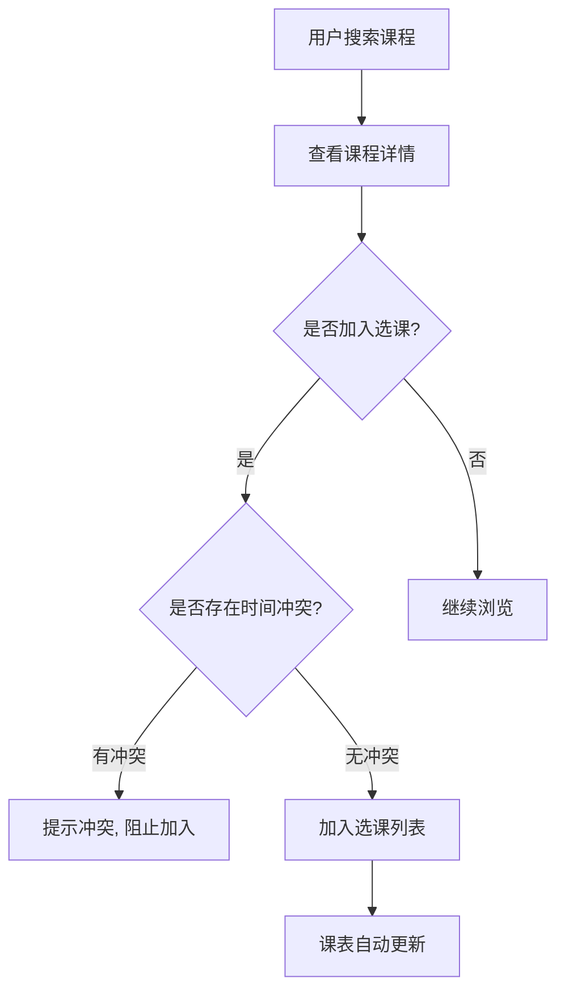
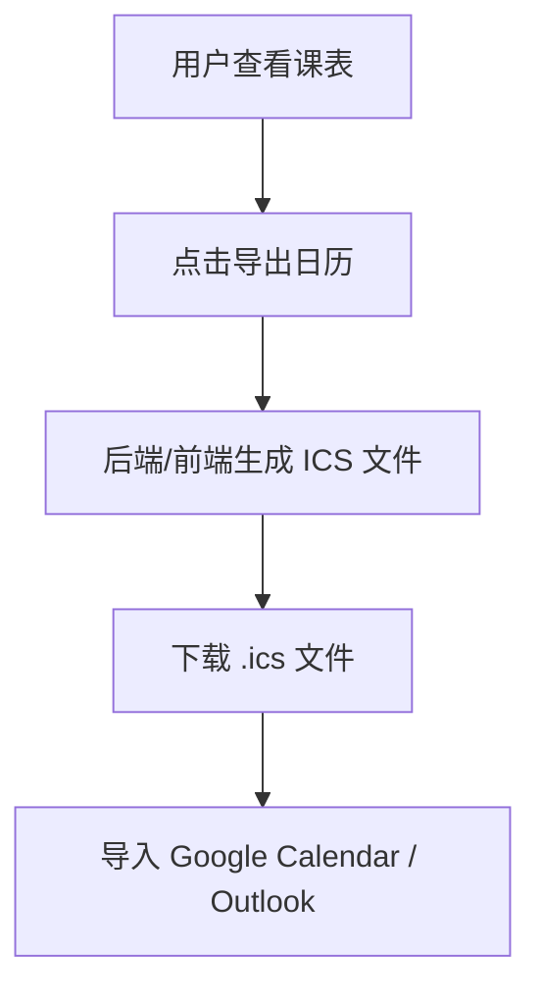

# 课程查询与选课排课系统（course-plus）产品需求文档（PRD）

| 项目名称 | 课程查询与选课排课系统（course-plus） |
| --- | --- |
| 文档版本 | v0.1（草稿） |
| 编写日期 | 2026-08-26 |
| 文档状态 | 草稿，待评审 |
| 目标读者 | 产品、设计、前后端开发、测试 |

---

## 1. 项目背景与目标

### 1.1 背景
学生在每学期选课时，通常需要面对大量课程信息，手动筛选、记录并规划课表，过程繁琐且容易出错。现有选课系统往往只提供简单的课程列表，缺乏直观的课表可视化与冲突检测能力。

### 1.2 产品目标
构建一个帮助用户**查询课程、管理选课、生成可视化课表**的 Web 应用，核心价值在于：

1. **高效查询**：快速定位感兴趣的课程。
2. **便捷管理**：集中管理个人选课列表。
3. **直观排课**：自动生成周课表并支持手动调整。
4. **无缝导出**：将课表导出为 ICS 文件，导入主流日历应用。

### 1.3 成功指标（建议）
- 课程查询响应时间 < 500ms。
- 选课列表操作（增/删）即时反馈。
- 课表生成准确率 100%（无冲突遗漏）。
- ICS 文件可被 Google Calendar / Outlook 正常导入。

---

## 2. 用户角色

| 角色 | 描述 | 核心诉求 |
| --- | --- | --- |
| **普通用户（学生）** | 查询课程、选课、查看课表、导出日历 | 快速找到课程、避免时间冲突、方便导出 |
| **管理员（可选，待确认）** | 维护课程数据、管理用户 | 课程增删改、用户管理 |

> ⚠️ **待确认项**：是否需要管理员角色？若需要，其权限范围如何界定？

---

## 3. 功能需求

### 3.1 课程查询
- **关键词搜索**：按课程名称、课程代码、教师姓名进行模糊搜索。
- **分类筛选**：按课程分类（如必修/选修、专业方向）筛选。
- **属性筛选**：按学分、上课时间、上课地点、授课教师等属性筛选。
- **结果展示**：以列表形式展示课程卡片，包含课程名、代码、学分、教师、时间、地点、剩余名额等关键信息。

### 3.2 选课管理
- **加入选课**：将课程加入「我的选课列表」。
- **移除选课**：从选课列表中移除课程。
- **冲突提示**：加入课程时，若与已有选课存在时间冲突，给出明确提示。
- **选课列表**：集中展示已选课程，支持增删操作。

### 3.3 排课表
- **自动生成**：根据已选课程自动生成一周课表（周一至周日 × 节次）。
- **手动调整**：支持手动调整课程在课表中的位置（如拖动）。
- **冲突检测**：自动检测并高亮时间冲突的课程。

### 3.4 导出日历
- **ICS 导出**：将当前课表导出为 `.ics` 文件。
- **兼容性**：生成的 ICS 文件可导入 Google Calendar、Outlook、Apple Calendar 等主流日历应用。

---

## 4. 非功能需求

| 类别 | 需求 |
| --- | --- |
| **性能** | 课程查询接口响应 < 500ms；页面首屏加载 < 2s |
| **可用性** | 界面简洁直观，关键操作（选课、导出）不超过 2 步 |
| **兼容性** | 支持主流浏览器（Chrome、Edge、Firefox、Safari 最新两个版本） |
| **可维护性** | 前后端分离，代码结构清晰，便于扩展 |
| **数据安全** | 用户数据（选课记录）需妥善存储与备份 |

---

## 5. 关键业务流程

### 5.1 选课流程

### 5.2 课表导出流程

---

## 6. 数据模型（草案）

| 表名 | 主要字段 | 说明 |
| --- | --- | --- |
| `courses` | id, name, code, category, credits, teacher, location, schedule, capacity | 课程信息 |
| `users` | id, username, password_hash, role | 用户信息 |
| `selections` | id, user_id, course_id, created_at | 用户选课记录 |
| `schedule_events` | id, user_id, course_id, day_of_week, start_slot, end_slot | 课表事件（支持手动调整） |

> ⚠️ **待确认项**：是否需要用户登录系统？若需要，认证方式（JWT / Session）待定。

---

## 7. 技术选型（待设计阶段确认）

| 层 | 候选方案 | 说明 |
| --- | --- | --- |
| **后端** | Rust（axum/actix）优先；备选 Node.js/TypeScript | 高性能、类型安全 |
| **前端** | React / Vue / Svelte（待定） | 组件化、生态成熟 |
| **数据库** | PostgreSQL / SQLite（待定） | 关系型，适合结构化课程数据 |
| **ICS 生成** | 服务端生成 或 前端生成（待定） | 需讨论 |

---

## 8. 里程碑规划（建议）

| 阶段 | 内容 | 交付物 |
| --- | --- | --- |
| **M1 需求确认** | 确认角色、功能范围、冲突规则 | 定稿 PRD |
| **M2 设计** | 技术栈、API 设计、数据库设计 | 设计文档、架构图 |
| **M3 开发** | 前后端开发 | 可运行系统 |
| **M4 测试** | 单元/集成/端到端测试 | 测试报告 |
| **M5 验收** | 功能验收、部署 | 验收清单、部署文档 |

---

## 9. 待确认问题清单

1. 是否需要**管理员角色**？其权限范围？
2. 是否需要**用户登录/注册**？认证方式？
3. 课程数据的**来源**？（手动录入 / 导入 / 爬取）
4. 时间冲突的**判定规则**？（按节次 / 按具体时间）
5. ICS 文件由**服务端还是前端**生成？
6. 是否需要**移动端适配**？

---

## 10. 附录

### 10.1 术语表
| 术语 | 含义 |
| --- | --- |
| ICS | iCalendar 文件格式，用于日历数据交换 |
| 节次 | 一天中划分的固定上课时间段 |
| 选课列表 | 用户已选择的课程集合 |

### 10.2 参考
- [iCalendar 规范 (RFC 5545)](https://datatracker.ietf.org/doc/html/rfc5545)